# Prediqo — AI Analytics Platform Context

> **Living Context Document**: This file maintains the core mental model, architectural design, component responsibilities, data flow, API contracts, and troubleshooting guide for Prediqo. Update this file whenever new modules, endpoints, or architectural changes are introduced.

---

## 1. Project Overview & Philosophy

**Prediqo** is a local-first AI data analytics platform inspired by Julius AI and Databricks. It provides an end-to-end analytics workflow:

```text
Connect Data → Standardize Data → Explore Data → Ask Questions (NL)
             → Run Analysis (DuckDB) → Generate Charts → Pin to Dashboard
```

### Core Design Principles
- **"Prepare Once, Analyze Many Times" (Phase 2.5)**: Complete separation between the **Ingestion Path** (source reading, column standardization, profiling, semantic inference, Parquet persistence) and the **Query Path** (AI analyst, query planner, validator, DuckDB execution). Asking questions or browsing data never repeats source reading, re-profiling, or full DataFrame instantiation.
- **Local-First & Zero Infra Burden**: Runs entirely locally without Docker, external database servers, Celery, or Redis. Uses lightweight in-process threading for background jobs.
- **Fast Columnar Analytics**: Uses **DuckDB** querying **Parquet directly** with column pruning, filter push-down, and canonical SHA-256 query result caching for sub-10ms responses.
- **Deterministic by Default, AI-Enhanced**: Includes a rule-based deterministic Natural Language parser that works 100% offline without API keys, plus optional multi-provider LLM support (OpenAI, Groq, Gemini, Anthropic, Custom).
- **Faithful & Safe Insights**: Derived strictly from actual query result rows without hallucinating metrics or numbers.
- **Clean Modular Monolith**: Modular separation of Ingestion, Jobs, Storage, Cache, Semantic Intelligence, Query Engine, AI, and Dashboards within a single FastAPI application.

---

## 2. Tech Stack Summary

| Component | Technology | Primary Role |
|---|---|---|
| **Frontend** | React 19, TypeScript, Vite 8, Tailwind CSS | SPA with responsive dark/light UI |
| **Data Viz** | Recharts 3 | Bar, Line, Pie, Area, Scatter, and KPI charts |
| **Backend** | Python 3.13, FastAPI, Uvicorn | Async REST API, file upload handling, query orchestration |
| **Analytics Engine**| DuckDB, PyArrow, Pandas | In-process SQL over Parquet, column pruning, filter push-down |
| **Ingestion & Jobs**| ThreadPoolExecutor, JSON Job Store | Multi-stage background ingestion and versioned refresh |
| **Query Cache** | File-based Canonical SHA-256 Hash | Sub-10ms cached query responses with version invalidation |
| **AI Layer** | Pydantic Query Plan, Multi-Provider LLMs, Rule-based NLP | NL question translation to structured queries |
| **Storage** | Local Filesystem (`data/uploads`, `data/datasets`, `data/metadata`, `data/jobs`, `data/cache`) | Parquet analytical storage + JSON metadata/jobs/cache |

---

## 3. Directory Layout & Module Responsibilities

```text
D:\AIML\prediqo-v1/
├── CONTEXT.md                       # This living context document
├── README.md                        # Quickstart and acceptance tests
├── docs/
│   ├── ARCHITECTURE.md              # Deep dive into query execution, jobs, & caching
│   ├── ANALYTICS.md                 # Analytical engine, DuckDB execution, semantic guardrails, caching
│   ├── PREDICTION.md                # Supervised ML prediction, target detection, CV, inference
│   ├── FORECASTING.md               # Time-series forecasting, DuckDB aggregation, backtesting, intervals
│   └── DEVELOPMENT_GUIDE.md         # Guide for adding connectors, charts, providers, benchmarks
├── scripts/
│   ├── benchmark_large_dataset.py   # Benchmark script for 100k and 1M row datasets
│   ├── benchmark_results.json       # Persisted benchmark timings and compression metrics
│   └── verify_acceptance_workflow.py# 10-step Section 35 acceptance workflow verification
├── backend/
│   ├── requirements.txt             # Pinned Python dependencies
│   ├── requirements-flex.txt        # Flexible version requirements
│   ├── tests/
│   │   ├── test_core.py             # Unit tests for standardization, parsing, execution
│   │   ├── test_ai_analyst.py       # Integration tests for AI analyst & providers
│   │   ├── test_semantic_intelligence.py # Semantic intelligence & aggregation policy tests
│   │   └── test_phase25_architecture.py # Ingestion jobs, cache, versioning, DuckDB Parquet tests
│   └── app/
│       ├── main.py                  # FastAPI application entrypoint & CORS
│       ├── api/
│       │   └── routes.py            # API routing for jobs, datasets, explorer, AI, dashboards
│       ├── core/
│       │   └── config.py            # Dynamic paths (ROOT_DIR, DATA_DIR, CACHE_DIR, JOBS_DIR)
│       ├── models/
│       │   ├── dataset.py           # DatasetStatus enum & DatasetMetadata model
│       │   └── schemas.py           # Pydantic schemas (queries, plans, configs, charts)
│       ├── jobs/                    # Asynchronous ingestion job subsystem
│       │   ├── job_models.py        # JobStatus, JobStage, IngestionJob schemas
│       │   ├── job_manager.py       # ThreadPoolExecutor background runner & JSON persistence
│       │   └── ingestion_job.py     # Stage-by-stage worker execution function
│       ├── ingestion/               # Decoupled data preparation pipeline
│       │   ├── pipeline.py          # Sequential stages: read, standardize, profile, semantic, store
│       │   └── service.py           # High-level ingestion and refresh triggers
│       ├── connectors/              # Raw data source extractors
│       │   ├── base.py              # DataConnector ABC abstract interface
│       │   ├── registry.py          # Central connector resolver & registry
│       │   ├── csv_connector.py     # CSV reader
│       │   ├── excel_connector.py   # Excel (.xlsx / .xls) reader
│       │   ├── google_sheets_connector.py # Public Google Sheets connector
│       │   └── postgres_connector.py      # PostgreSQL table extractor
│       ├── standardization/         # Data cleaning & profiling
│       │   ├── standardizer.py      # Cleans columns, strips whitespace, converts types
│       │   ├── semantics.py         # Business role inference, aggregation policy, derived metrics
│       │   └── profiler.py          # Computes dataset profiling & stats
│       ├── profiling/               # Profiling helpers & semantic type inference
│       ├── storage/                 # Storage abstraction layer
│       │   ├── dataset_store.py     # Reads/writes parquet & metadata json (reconstruction without profiling)
│       │   └── dashboard_store.py   # Query-spec dashboard persistence & dynamic population
│       ├── prediction/              # Supervised ML prediction layer
│       │   ├── models.py            # Feasibility, train, predict Pydantic schemas (CV metrics, actual-vs-pred)
│       │   ├── feasibility.py       # Prediction feasibility analyzer
│       │   ├── target_detector.py   # Target detection & validation
│       │   ├── feature_selector.py  # Feature recommendation & correlation leakage prevention
│       │   ├── data_preparation.py  # DuckDB column projection, date features, ColumnTransformer
│       │   ├── trainer.py           # Candidate model training (Linear, RF, Gradient Boosting)
│       │   ├── evaluator.py         # K-Fold CV & holdout evaluation, model selection (MAE / F1)
│       │   ├── feature_importance.py# Feature importance & coefficient extraction
│       │   ├── model_store.py       # Joblib persistence & version validation
│       │   ├── predictor.py         # Single-record inference & explanation
│       │   └── service.py           # PredictionService orchestrator
│       ├── forecasting/             # Time-series forecasting intelligence layer
│       │   ├── models.py            # Forecast feasibility, train, predict Pydantic schemas
│       │   ├── feasibility.py       # Eligibility, period sufficiency, date/metric detection, staleness
│       │   ├── data_preparation.py  # DuckDB Parquet aggregation, date_trunc, frequency alignment
│       │   ├── trainer.py           # Naive, Seasonal Naive, Moving Average, Linear Trend, SES
│       │   ├── evaluator.py         # Chronological backtesting, MAE/RMSE/WAPE/MAPE, Naive comparison
│       │   ├── forecaster.py        # Future projection & 80%/95% uncertainty intervals
│       │   ├── model_store.py       # JSON model persistence, metadata & forecast storage
│       │   └── service.py           # ForecastingService orchestrator
│       ├── capabilities/            # Centralized schema flexibility & capability registry
│       │   ├── models.py            # Capability schemas, granularity reports, mapping models
│       │   └── registry.py          # Independent prediction & forecasting eligibility, overrides
│       ├── query_engine/            # DuckDB direct Parquet analytics
│       │   ├── parser.py            # Deterministic rule-based NL to StructuredQuery
│       │   ├── executor.py          # DuckDB SQL generator & executor (Parquet direct, column pruning)
│       │   └── insights.py          # Automated summary insights generator
│       ├── cache/                   # Query caching subsystem
│       │   └── query_cache.py       # Canonical SHA-256 query cache with version invalidation
│       ├── charts/
│       │   └── recommender.py       # Heuristics for auto-selecting chart types
│       ├── services/
│       │   └── analyst.py           # End-to-end question answering pipeline
│       └── ai/                      # AI Analyst & LLM planning
│           ├── analyst.py           # AI question workflow with schema context & cache check
│           ├── query_planner.py     # Generates AIQueryPlan via LLM
│           ├── query_validator.py   # Validates AIQueryPlan against real dataset schema
│           ├── suggestion_engine.py # Contextual starter questions from schema metadata
│           ├── prompts.py           # Prompts & metadata serialization (no DataFrame loading)
│           ├── llm_client.py        # Multi-provider client abstraction
│           └── openai_client.py     # OpenAI API client
├── frontend/
│   ├── package.json                 # Node scripts & dependencies
│   ├── vite.config.ts               # Vite configuration with /api reverse proxy
│   └── src/
│       ├── main.tsx                 # React entrypoint
│       ├── App.tsx                  # React Router routes setup
│       ├── types/index.ts           # Shared TypeScript interfaces (prediction, forecasting, capabilities)
│       ├── services/api.ts          # Axios wrapper for jobs, datasets, prediction, forecasting, capabilities
│       ├── components/
│       │   ├── Layout.tsx           # Navigation bar & layout shell
│       │   ├── DatasetPicker.tsx    # Dataset selector dropdown
│       │   ├── ChartCard.tsx        # Dashboard card container with action buttons
│       │   ├── PredictionTab.tsx    # Supervised ML: feasibility, CV training, holdout chart, live predict
│       │   ├── ForecastingTab.tsx   # Time-series: aggregation, backtesting, Recharts forecast & intervals
│       │   └── CapabilitiesTab.tsx  # Granularity assessment, semantic concept mappings & manual overrides
│       ├── charts/
│       │   └── Chart.tsx            # Recharts renderer (Bar, Line, Pie, Area, Scatter, KPI)
│       └── pages/
│           ├── DataSourcesPage.tsx  # Non-blocking upload with visual multi-stage job checklist
│           ├── DatasetsPage.tsx     # Dataset list with status badges, version pills, and refresh
│           ├── DatasetDetailPage.tsx# Dataset metadata, column types, and profile
│           ├── DataExplorerPage.tsx # Server-side DuckDB paginated table, sorting, and search
│           ├── AnalystPage.tsx      # Natural language chat with execution timing pills
│           ├── PredictionPage.tsx   # Prediction, Forecasting, and Capabilities tabs
│           ├── ChartBuilderPage.tsx # Manual visual query & chart builder
│           └── DashboardPage.tsx    # Saved charts grid using stored query specs
└── data/
    ├── uploads/                     # Original uploaded files (.csv, .xlsx)
    ├── datasets/                    # Standardized Parquet files (`ds_<id>.parquet` or partitioned dirs)
    ├── metadata/                    # JSON metadata (`ds_<id>.json`, `dashboard_*.json`)
    ├── jobs/                        # Persisted IngestionJob JSON records
    ├── models/                      # Persisted ML model pipelines and metadata (`model_<id>/`)
    └── cache/
        └── query/                   # Persisted SHA-256 query result JSON caches
```

---

## 4. End-to-End Architecture: Ingestion vs Query Path

```mermaid
flowchart TD
    subgraph INGESTION_PATH ["1. Ingestion Path (Run Once)"]
        Source["Data Source (Upload / Sheets / DB)"] --> Connector["DataConnector"]
        Connector --> Stage1["Stage: READING"]
        Stage1 --> Stage2["Stage: STANDARDIZING"]
        Stage2 --> Stage3["Stage: PROFILING"]
        Stage3 --> Stage4["Stage: SEMANTIC_ANALYSIS"]
        Stage4 --> Stage5["Stage: WRITING (Parquet)"]
        Stage5 --> Stage6["Stage: METADATA (JSON)"]
        Stage6 --> Ready["Dataset Status: READY (v1)"]
    end

    subgraph QUERY_PATH ["2. Query Path (Run Many Times)"]
        UserQ["User NL Question"] --> AI["AI Analyst / Parser"]
        Meta["Persisted Metadata JSON"] -.-> AI
        AI --> Plan["Validated Query Plan"]
        Plan --> CacheCheck{"QueryCache Hit?"}
        CacheCheck -- Yes --> CachedRes["Sub-10ms Cached Result"]
        CacheCheck -- No --> DuckDB["DuckDB Execution"]
        ParquetFile[("data/datasets/{id}.parquet")] --> DuckDB
        DuckDB --> Result["Column-Pruned Result Rows"]
        Result --> SaveCache["Store in QueryCache"]
        Result --> Viz["Chart & Insight Render"]
    end
```



---

## 5. Dataset Lifecycle & Versioning

### Dataset States
- **`CREATING`**: Initial job creation and registration.
- **`PROCESSING`**: Background ingestion pipeline running. Queries return HTTP 400.
- **`READY`**: Ingestion complete; dataset is queryable.
- **`FAILED`**: Ingestion encountered an error; error stored in metadata.
- **`STALE`**: Underlying source modified and awaiting refresh.

### Versioning & Refresh Behavior
- Datasets start at `version = 1`.
- Calling `POST /api/datasets/{dataset_id}/refresh` triggers a background job for `version = 2`.
- **Zero-Downtime Querying**: While the refresh job runs, the existing `v1` Parquet and metadata remain `READY` and actively serve queries.
- Upon completion, `v2` becomes the active version and replaces the dataset.
- Because query cache keys incorporate the dataset version, all previous cached results for `v1` are automatically invalidated.

---

## 6. DuckDB Query & Performance Architecture

### Parquet Direct Querying
Instead of loading DataFrames into memory, DuckDB executes directly over Parquet files:
```python
con.execute(f"CREATE VIEW t AS SELECT * FROM read_parquet('{parquet_path}')")
```

### Key Optimizations
1. **Column Pruning**: Queries only select the dimension and aggregated metric columns (e.g. `SELECT City, SUM(Total_Amount) FROM t GROUP BY City`), preventing scanning of unused columns.
2. **Filter Push-Down**: Filters are incorporated directly into SQL `WHERE` clauses, enabling Parquet row group skipping.
3. **Server-Side Data Explorer Pagination**: Data Explorer queries DuckDB directly with `LIMIT {page_size} OFFSET {offset}` along with `SELECT COUNT(*) FROM t`, eliminating memory transfer of large tables to the frontend.
4. **Hard Limit Safeguards**: Filter and exploratory queries enforce safety caps (`LIMIT 500` or `LIMIT 50`).
5. **Dashboard Query Specs**: Dashboards store query specifications rather than static row snapshots, refreshing data dynamically via DuckDB and `QueryCache`.

---

## 7. Key API Endpoints

| Method | Endpoint | Description |
|---|---|---|
| `GET` | `/api/health` | Service health status |
| `GET` | `/api/connectors` | List available data connectors |
| **`POST`** | **`/api/ingestion/jobs`** | **Start async background ingestion job (file upload)** |
| **`GET`** | **`/api/ingestion/jobs/{id}`** | **Get job status, stage, and progress** |
| **`GET`** | **`/api/ingestion/jobs`** | **List recent ingestion jobs** |
| `GET` | `/api/datasets` | List all standardized datasets with version and status |
| `GET` | `/api/datasets/{id}` | Full dataset metadata & profile (loaded from JSON without re-profiling) |
| **`POST`** | **`/api/datasets/{id}/refresh`** | **Trigger zero-downtime background dataset refresh** |
| **`GET`** | **`/api/datasets/{id}/preview`** | **Server-side DuckDB paginated preview (`page`, `page_size`, `sort_col`, `search`)** |
| `GET` | `/api/datasets/{id}/semantic-model` | Complete semantic model (business roles, metrics, allowed aggs) |
| `DELETE`| `/api/datasets/{id}` | Delete dataset parquet, metadata, and cached entries |
| **`GET`** | **`/api/prediction/feasibility/{id}`** | **Check ML prediction feasibility, targets, and warnings** |
| **`POST`** | **`/api/prediction/train`** | **Train candidate models (Linear, RF, GB) with K-Fold CV & select best** |
| **`GET`** | **`/api/prediction/models/{id}`** | **List trained models for dataset or get model details** |
| **`POST`** | **`/api/prediction/predict`** | **Single-record prediction with probabilities & explanation** |
| **`GET`** | **`/api/forecast/feasibility/{id}`** | **Check time-series forecasting feasibility, dates, metrics, and staleness** |
| **`POST`** | **`/api/forecast/train`** | **Train forecasting models with chronological backtest & 80%/95% intervals** |
| **`GET`** | **`/api/forecast/models/{id}`** | **List trained forecast models for dataset or get model details** |
| **`POST`** | **`/api/forecast/predict`** | **Generate projection for saved forecast model with custom horizon** |
| **`GET`** | **`/api/capabilities/{id}`** | **Assess dataset prediction & forecasting capabilities, granularity, mappings** |
| **`POST`** | **`/api/capabilities/{id}`** | **Override canonical field mappings and re-assess capabilities** |
| `POST` | `/api/query` | Execute question or structured query |
| `POST` | `/api/chart` | Execute manual ChartSpec query |
| `GET` | `/api/ai/providers` | List available & configured LLM providers |
| `POST` | `/api/ai/analyze` | AI Analyst endpoint (checks cache, queries DuckDB over Parquet, returns timing) |
| `GET` | `/api/ai/suggestions/{id}` | Schema-aware sample analytical questions |
| `GET` | `/api/dashboards` | List dashboards |
| `GET` | `/api/default-dashboard` | Get default dashboard with dynamically populated charts |
| `GET` | `/api/dashboards/{id}` | Get dashboard configuration & charts |
| `POST` | `/api/dashboards/{id}/charts`| Pin chart to dashboard with stored query spec |
| `DELETE`| `/api/dashboards/{id}/charts/{cid}` | Remove chart from dashboard |

---

## 8. Semantic Intelligence Architecture (Phase 2)

Prediqo's Semantic Intelligence layer (`backend/app/standardization/semantics.py`) equips the AI analyst with business-level comprehension of datasets without replacing DuckDB or creating duplicate classification systems.

### 1. Extended Column Metadata (`ColumnMeta`)
Every column retains its fundamental `semantic_type` (`ID`, `DIMENSION`, `MEASURE`, `DATE`, `CATEGORY`, `TEXT`) and is extended with:
- `business_role: str` (e.g. `order_identifier`, `revenue`, `quantity`, `duration`, `rating`, `geography`, `status`, or `unknown`).
- `display_name: str` (e.g. "Order ID", "Total Revenue", "Delivery Days").
- `allowed_aggregations: list[str]` (allowed SQL functions strictly enforced by query validator).

### 2. Central Aggregation Policy Matrix
| Semantic Type | Business Role | Allowed Aggregations | Disallowed Aggregations |
|---|---|---|---|
| `ID` | `order_identifier`, etc. | `COUNT`, `DISTINCT_COUNT` | `SUM`, `AVG`, `MIN`, `MAX` |
| `MEASURE` | `revenue`, `cost`, `quantity`, `monetary_amount` | `SUM`, `AVG`, `MIN`, `MAX`, `COUNT`, `DISTINCT_COUNT` | — |
| `MEASURE` | `rating`, `duration`, `rate`, `percentage` | `AVG`, `MIN`, `MAX`, `COUNT`, `DISTINCT_COUNT` | `SUM` |
| `CATEGORY` / `DIMENSION` | `category`, `geography`, `status` | `COUNT`, `DISTINCT_COUNT` | `SUM`, `AVG` |
| `DATE` | `transaction_date`, etc. | `COUNT`, `DISTINCT_COUNT` | `SUM`, `AVG` |

### 3. Intelligent Metric Discovery
Derived analytical metrics are computed deterministically from real columns:
- `order_identifier` $\rightarrow$ `Total Orders` (`COUNT(order_id)`)
- `customer_identifier` $\rightarrow$ `Total Customers` (`DISTINCT_COUNT(customer_id)`)
- `revenue` $\rightarrow$ `Total Revenue` (`SUM(revenue)`), `Average Order Value` (`AVG(revenue)`)
- `quantity` $\rightarrow$ `Units Sold` (`SUM(quantity)`)
- `duration` $\rightarrow$ `Average Delivery Time` (`AVG(delivery_days)`)
- `rating` $\rightarrow$ `Average Customer Rating` (`AVG(customer_rating)`)

---

## 9. Benchmark Performance Summary (Phase 2.5)

Benchmarks against real-world transactional data on local disk ([`scripts/benchmark_results.json`](file:///D:/AIML/prediqo-v1/scripts/benchmark_results.json)):

- **100,000 Rows**:
  - Raw CSV: 6.64 MB $\rightarrow$ Parquet: 2.01 MB (3.3x compression).
  - One-time Ingestion: 4.04s.
  - DuckDB Simple Aggregation: **49.8 ms**.
  - DuckDB Filtered Aggregation: **23.3 ms**.
  - DuckDB Data Explorer Preview (100 rows): **13.1 ms**.
  - Query Cache Hit: **7.19 ms**.
- **1,000,000 Rows**:
  - Raw CSV: 66.37 MB $\rightarrow$ Parquet: 18.12 MB (3.66x compression).
  - One-time Ingestion: 39.46s.
  - DuckDB Simple Aggregation: **47.1 ms**.
  - DuckDB Filtered Aggregation: **39.3 ms**.
  - DuckDB Top-N Ranking: **37.0 ms**.
  - DuckDB Data Explorer Preview (100 rows): **10.65 ms**.
  - Query Cache Hit: **7.40 ms**.

---

## 10. Known Quirks, Resolved Bugs & Best Practices

1. **Parquet Direct Execution**:
   - DuckDB views are registered directly via `CREATE VIEW t AS SELECT * FROM read_parquet('path')`. Column pruning and filter push-downs happen natively inside DuckDB.
2. **Metadata-Driven Context**:
   - The AI Analyst, Prompts, and Suggestion Engine build schema context strictly from persisted metadata JSON files, completely avoiding reading Parquet or initializing Pandas DataFrames during query execution.
3. **Strict JSON NaN Sanitization**:
   - All output rows map `pd.isna(v) -> None` before float rounding to guarantee JSON compliant `null` values.
4. **Vite Reverse Proxy**:
   - Frontend runs on `http://127.0.0.1:5173` and proxies `/api/*` requests to `http://127.0.0.1:8000`.
5. **Multi-Provider Fallback**:
   - In offline mode or if LLM provider keys are missing, the query engine automatically executes via the deterministic rule-based parser.

---

## 11. Prediction & Forecasting Intelligence Layer (Phase 1 & Phase 2)

### 1. Architectural Distinction: Prediction vs Forecasting
Prediqo strictly separates supervised record-level ML prediction from time-series forecasting:
- **Prediction (`backend/app/prediction/`)**: Learns patterns across rows to predict a target variable (numeric regression or categorical classification) for independent records. Evaluated via K-Fold cross-validation and holdout validation.
- **Forecasting (`backend/app/forecasting/`)**: Aggregates chronological events over regular intervals (daily, weekly, monthly) using DuckDB directly over Parquet, evaluates candidate models via chronological backtesting against a Naive benchmark, and projects future horizons with empirical 80% and 95% uncertainty intervals.
- **Capability Registry (`backend/app/capabilities/`)**: Evaluates prediction and forecasting eligibility independently, inspects dataset granularity (transaction vs order-item repeated totals), detects canonical concept mappings with confidence scores, and allows manual overrides.

### 2. Supported Forecasting Algorithms
1. **Naive (Last Observed Value)**: $\hat{y}_{t+h} = y_t$ (mandatory benchmark).
2. **Seasonal Naive**: Repeats the most recent seasonal cycle (e.g. 7-day weekly seasonality for daily data, 12-month seasonality for monthly data).
3. **Moving Average**: Projects the mean of the most recent window ($W \in [2, 7]$).
4. **Linear Trend Regression**: Fits OLS $y_t = \beta_0 + \beta_1 t$ with non-negative lower bounding.
5. **Exponential Smoothing**: Simple Exponential Smoothing (SES) with grid-searched optimal smoothing factor $\alpha$.

### 3. Chronological Backtesting & Metric Integrity
- **No Random Shuffling**: Validation split preserves temporal order (train on past, evaluate on subsequent $H$ periods).
- **Zero-Safety in Metrics**:
  - **MAE**: Mean Absolute Error on holdout.
  - **RMSE**: Root Mean Squared Error.
  - **WAPE**: $\frac{\sum |y - \hat{y}|}{\sum |y|} \times 100\%$ when $\sum |y| > 0$.
  - **MAPE**: Calculated only when $y \ne 0$; gracefully reported as `undefined` when actual series contains zero values to avoid division-by-zero distortion.
- **Baseline Comparison**: All candidates report relative improvement over Naive baseline (`vs_naive_pct`).

### 4. Data Granularity & Staleness Protection
- **Staleness Detection**: Compares the dataset's latest observation date against current time. If cutoff is $> 60$ days in the past, models and UI flag output as a historical projection rather than real-time forecast.
- **Granularity Awareness**: Distinguishes discrete transactions from order-item line items with repeated order IDs, ensuring order counts use `DISTINCT_COUNT` and order totals are not silently multiplied.
- **Missing Period Policy**: Aggregations over Parquet via DuckDB reindex to a continuous calendar frequency. Additive metrics (SUM, COUNT) are imputed with 0.0 with warning notes; non-additive metrics (AVG) use forward-fill.

