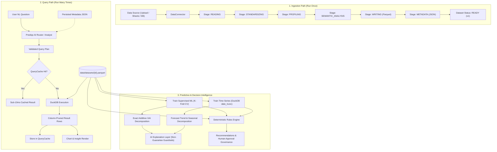

# Prediqo — AI Analytics Platform Context

> **Living Context Document**: This file maintains the core mental model, architectural design, component responsibilities, data flow, API contracts, and troubleshooting guide for Prediqo. Update this file whenever new modules, endpoints, or architectural changes are introduced.

---

## 1. Project Overview & Philosophy

**Prediqo** is a local-first AI-powered data analytics, predictive intelligence, and decision platform inspired by Julius AI, Tellius, and Databricks. It provides an end-to-end analytics workflow:

```text
Connect Data → Standardize Data → Explore Data → Ask Questions (NL Router / Chat)
             → Run Analysis (DuckDB) → Predict & Forecast (Supervised ML & Time Series)
             → Explain Results (Exact XAI & AI Narratives) → Business Decisions & Approvals
```

### Core Design Principles
- **"Prepare Once, Analyze Many Times"**: Complete architectural separation between the **Ingestion Path** (source reading, column standardization, profiling, semantic inference, Parquet persistence) and the **Query / Serving Path** (AI analyst, query planner, validator, DuckDB execution, ML training & inference, forecasting, decision rules). Asking questions or browsing data never repeats source reading, re-profiling, or full DataFrame instantiation.
- **Local-First & Zero Infra Burden**: Runs entirely locally without Docker, external database servers, Celery, or Redis. Uses lightweight in-process threading for background jobs, local JSON stores for metadata/decisions/models, and fast in-process columnar querying.
- **Fast Columnar Analytics**: Uses **DuckDB** querying **Parquet directly** with column pruning, filter push-down, and canonical SHA-256 query result caching for sub-10ms responses.
- **Strict Separation Between ML Computation & LLM Reasoning**: All numbers, metrics, predictions, probabilities, attributions, and intervals originate exclusively from mathematically verified computational engines (scikit-learn, DuckDB, deterministic rules). The LLM is strictly a language synthesis and presentation layer—never an authoritative source of truth.
- **Faithful & Safe Insights**: Governed by strict non-guarantee policies, negation-aware disclaimer filtering, prohibited causal language checks, bounded corrective retries, and high-performance deterministic offline fallbacks.
- **Human-in-the-Loop Decision Governance**: Recommendations generated by a deterministic rules engine require human review with explicit states (`needs_review`, `pending_approval`, `approved`, `rejected`, `dismissed`, `completed`) and mandatory comments on rejection/dismissal.
- **Clean Modular Monolith**: Modular separation of Ingestion, Jobs, Storage, Cache, Semantic Intelligence, Query Engine, Capabilities Registry, Prediction, Forecasting, Explainability, AI Explanations, Decisions, and Dashboards within a single FastAPI application.

---

## 2. Tech Stack Summary

| Component | Technology | Primary Role |
|---|---|---|
| **Frontend** | React 19, TypeScript, Vite 8, Tailwind CSS | SPA with responsive dark/light UI and Lucide icons |
| **Data Viz** | Recharts 3 | Bar, Line, Pie, Area, Scatter, Residual, and KPI charts |
| **Backend** | Python 3.13, FastAPI, Uvicorn | Async REST API, file upload handling, query & ML orchestration |
| **Analytics Engine**| DuckDB, PyArrow, Pandas | In-process SQL over Parquet, column pruning, filter push-down |
| **Ingestion & Jobs**| ThreadPoolExecutor, JSON Job Store | Multi-stage background ingestion and versioned refresh |
| **Query Cache** | File-based Canonical SHA-256 Hash | Sub-10ms cached query responses with version invalidation |
| **Prediction Engine**| scikit-learn, joblib | Supervised regression & classification, K-Fold CV, leakage detection |
| **Forecasting Engine**| DuckDB date_trunc, scikit-learn | Naive, Seasonal Naive, Moving Avg, Linear Trend, SES, backtesting, intervals |
| **Explainable AI (XAI)**| Exact Tree Paths, Additive Decomp | Exact local feature attributions, grouped categoricals, forecast decompositions |
| **AI Explanations** | Multi-Provider LLMs + Ollama + Fallback | Business narrative generation with non-guarantee guardrails and caching |
| **Decision Layer** | Deterministic Rules Engine | Rule evaluation, evidence collection, recommendation store, human approvals |
| **Question Router** | Rule-Based + LLM Intent Classifier | Intelligent routing between Analytics, Prediction, Forecasting, and Decisions |
| **Storage** | Local Filesystem (`data/`) | Parquet analytical files + JSON metadata, jobs, cache, models, decisions |

---

## 3. Directory Layout & Module Responsibilities

```text
D:\AIML\prediqo-v2/
├── CONTEXT.md                       # Living context document (mental model & contracts)
├── README.md                        # Quickstart, architecture overview, and acceptance tests
├── docs/
│   ├── ARCHITECTURE.md              # Deep dive into modular monolith, queries, jobs, & caching
│   ├── ANALYTICS.md                 # Analytical engine, DuckDB execution, semantic guardrails
│   ├── PREDICTION.md                # Supervised ML prediction, target detection, CV, inference
│   ├── FORECASTING.md               # Time-series forecasting, DuckDB aggregation, backtesting, intervals
│   ├── DECISION_LAYER_GUIDE.md      # Deterministic rules engine, evidence collection, human approvals
│   ├── AI_EXPLANATIONS.md           # Business explanation layer, Ollama, non-guarantee safety, retries
│   ├── EXPLAINABILITY.md            # Generic local/global XAI, exact tree paths, forecast attribution
│   ├── BUSINESS_PREDICTION_GUIDE.md # Plain-English user guide for predictions and forecasts
│   └── DEVELOPMENT_GUIDE.md         # Guide for setup, test commands, rules, models, and benchmarks
├── scripts/
│   ├── generate_sample_data.py      # Generates synthetic e-commerce transactional dataset
│   ├── benchmark_large_dataset.py   # Benchmark script for 100k and 1M row datasets
│   ├── benchmark_results.json       # Persisted benchmark timings and compression metrics
│   └── verify_acceptance_workflow.py# 10-step Section 35 acceptance workflow verification
├── backend/
│   ├── requirements.txt             # Pinned Python dependencies
│   ├── requirements-flex.txt        # Recommended flexible version requirements
│   ├── tests/
│   │   ├── test_core.py             # Core parser, standardization, execution (7 tests)
│   │   ├── test_ai_analyst.py       # AI analyst & LLM provider tests (11 tests)
│   │   ├── test_semantic_intelligence.py # Semantic intelligence & aggregation policy tests (9 tests)
│   │   ├── test_phase25_architecture.py # Ingestion jobs, cache, versioning, DuckDB Parquet tests (8 tests)
│   │   ├── test_prediction.py       # Supervised ML training, K-Fold CV, residuals, inference (13 tests)
│   │   ├── test_forecasting.py      # DuckDB Parquet aggregation, backtest, intervals, staleness (10 tests)
│   │   ├── test_flexibility_and_capabilities.py # Datasets A-E, granularity, manual overrides (9 tests)
│   │   ├── test_phase3_reliability.py # Reliability edge cases, zero-variance, class imbalance (18 tests)
│   │   ├── test_explainability.py   # Exact additive tree paths, grouped one-hot, forecast XAI (22 tests)
│   │   ├── test_decisions.py        # Rules engine, operators, evaluations, human approvals (15 tests)
│   │   └── test_ai_explanations.py  # Clause validation, disclaimer scope, retries, fallback, cache (34 tests)
│   └── app/
│       ├── main.py                  # FastAPI application entrypoint, middleware, CORS
│       ├── api/
│       │   └── routes.py            # API routing for jobs, datasets, explorer, query, charts, dashboards
│       ├── core/
│       │   └── config.py            # Dynamic paths (ROOT_DIR, DATA_DIR, CACHE_DIR, JOBS_DIR, MODELS_DIR)
│       ├── models/
│       │   ├── dataset.py           # DatasetStatus enum & DatasetMetadata model
│       │   └── schemas.py           # Pydantic schemas (queries, plans, configs, charts)
│       ├── jobs/                    # Asynchronous ingestion job subsystem
│       │   ├── job_models.py        # JobStatus, JobStage, IngestionJob schemas
│       │   ├── job_manager.py       # ThreadPoolExecutor background runner & JSON persistence
│       │   └── ingestion_job.py     # Stage-by-stage worker execution function
│       ├── ingestion/               # Decoupled data preparation pipeline
│       │   ├── pipeline.py          # Sequential stages: read, standardize, profile, semantic, store
│       │   └── service.py           # High-level ingestion and refresh triggers
│       ├── connectors/              # Raw data source extractors (CSV, Excel, Sheets, Postgres)
│       │   ├── base.py              # DataConnector ABC abstract interface
│       │   ├── registry.py          # Central connector resolver & registry
│       │   ├── csv_connector.py     # CSV reader
│       │   ├── excel_connector.py   # Excel (.xlsx / .xls) reader
│       │   ├── google_sheets_connector.py # Google Sheets connector
│       │   └── postgres_connector.py      # PostgreSQL table extractor
│       ├── standardization/         # Data cleaning, profiling, and semantic model
│       │   ├── standardizer.py      # Cleans columns, strips whitespace, converts types
│       │   ├── semantics.py         # Business role inference, aggregation policy, derived metrics
│       │   └── profiler.py          # Computes dataset profiling & stats
│       ├── profiling/               # Profiling helpers & semantic type inference
│       ├── storage/                 # Storage abstraction layer
│       │   ├── dataset_store.py     # Reads/writes parquet & metadata json
│       │   └── dashboard_store.py   # Query-spec dashboard persistence & dynamic population
│       ├── capabilities/            # Centralized schema flexibility & capability registry
│       │   ├── models.py            # Capability schemas, granularity reports, mapping models
│       │   └── registry.py          # Independent prediction & forecasting eligibility, overrides
│       ├── prediction/              # Supervised ML prediction layer
│       │   ├── models.py            # Feasibility, train, predict Pydantic schemas
│       │   ├── feasibility.py       # Prediction feasibility analyzer
│       │   ├── target_detector.py   # Target detection & validation
│       │   ├── feature_selector.py  # Feature recommendation & correlation leakage prevention
│       │   ├── data_preparation.py  # DuckDB column projection, date features, ColumnTransformer
│       │   ├── trainer.py           # Candidate model training (Linear, RF, Gradient Boosting)
│       │   ├── evaluator.py         # K-Fold CV & holdout evaluation, model selection (MAE / F1)
│       │   ├── feature_importance.py# Feature importance & coefficient extraction
│       │   ├── model_store.py       # Joblib persistence & version validation
│       │   ├── predictor.py         # Single-record inference & explanation
│       │   └── service.py           # PredictionService orchestrator
│       ├── forecasting/             # Time-series forecasting intelligence layer
│       │   ├── models.py            # Forecast feasibility, train, predict Pydantic schemas
│       │   ├── feasibility.py       # Eligibility, period sufficiency, date/metric detection, staleness
│       │   ├── data_preparation.py  # DuckDB Parquet aggregation, date_trunc, frequency alignment
│       │   ├── trainer.py           # Naive, Seasonal Naive, Moving Average, Linear Trend, SES
│       │   ├── evaluator.py         # Chronological backtesting, MAE/RMSE/WAPE/MAPE, Naive comparison
│       │   ├── forecaster.py        # Future projection & 80%/95% uncertainty intervals
│       │   ├── model_store.py       # JSON model persistence, metadata & forecast storage
│       │   └── service.py           # ForecastingService orchestrator
│       ├── explainability/          # Explainable AI (XAI) mathematical decomposition
│       │   ├── models.py            # Local/Global/Forecast XAI schemas
│       │   ├── feature_metadata.py  # Pipeline inspection, OneHotEncoder mapping, grouped contributions
│       │   ├── local_explainer.py   # Exact additive decomposition (Linear, Tree ensembles, Baselines)
│       │   ├── global_explainer.py  # Mean absolute contributions & collinearity detection
│       │   ├── forecasting_explainer.py # Trend slope, level state, seasonal cycles, backtest coverage
│       │   ├── service.py           # ExplainabilityService orchestrator
│       │   └── routes.py            # REST API endpoints for XAI
│       ├── decisions/               # Deterministic Decision Layer & Rules Engine
│       │   ├── models.py            # BusinessRule, Evaluation, Recommendation, AuditItem schemas
│       │   ├── rules_engine.py      # AST-free deterministic evaluator, comparison operators
│       │   ├── evidence_collector.py# Collects facts from datasets, predictions, forecasts, and user inputs
│       │   ├── store.py             # Local JSON persistence (`data/decisions/`), seed rules
│       │   ├── service.py           # DecisionService orchestrator, approvals, mandatory comments
│       │   └── routes.py            # REST API endpoints for /api/decisions/*
│       ├── query_engine/            # DuckDB direct Parquet analytics
│       │   ├── parser.py            # Deterministic rule-based NL to StructuredQuery
│       │   ├── executor.py          # DuckDB SQL generator & executor (Parquet direct, column pruning)
│       │   └── insights.py          # Automated summary insights generator
│       ├── cache/                   # Query caching subsystem
│       │   └── query_cache.py       # Canonical SHA-256 query cache with version invalidation
│       ├── charts/
│       │   └── recommender.py       # Heuristics for auto-selecting chart types
│       ├── services/
│       │   └── analyst.py           # End-to-end question answering pipeline
│       └── ai/                      # AI Analyst, LLM planning, and Business Explanations
│           ├── analyst.py           # AI question workflow with schema context & cache check
│           ├── query_planner.py     # Generates AIQueryPlan via LLM
│           ├── query_validator.py   # Validates AIQueryPlan against real dataset schema
│           ├── suggestion_engine.py # Contextual starter questions from schema metadata
│           ├── prompts.py           # Prompts & metadata serialization (no DataFrame loading)
│           ├── router.py            # Intelligent business question intent router & chat endpoint
│           ├── llm_client.py        # Multi-provider client abstraction (Ollama, OpenAI, Groq, Gemini, Claude)
│           ├── openai_client.py     # OpenAI API client
│           ├── explanation_models.py# Schemas for business explanation requests, responses, and evidence
│           ├── explanation_prompts.py # Constrained business prompts with non-guarantee instructions
│           ├── explanation_validator.py # Clause-level validator, negation & disclaimer scope detection
│           ├── narrative_fallback.py# High-performance deterministic fallback business explanations
│           ├── explanation_cache.py # Thread-safe SHA-256 evidence fingerprint caching (<5ms)
│           ├── explanation_service.py # Unified explanation pipeline, bounded corrective retries
│           └── explanation_routes.py# Endpoints for `/api/ai/explain/*` and `/api/v1/ai/explain/*`
├── frontend/
│   ├── package.json                 # Node scripts & dependencies
│   ├── vite.config.ts               # Vite configuration with /api reverse proxy
│   ├── tests/                       # Unit & business validation test suite (29 tests)
│   │   ├── businessMetrics.test.ts  # Units formatting, metric explanations, baseline uplifts (5 tests)
│   │   ├── xaiNarratives.test.ts    # Drivers, log-odds scale notices, forecast trends (5 tests)
│   │   ├── decisionRules.test.ts    # Rule operators, priority badges, terminal states, comments (5 tests)
│   │   ├── aiExplanation.test.ts    # AI explanation schema contracts and payloads (4 tests)
│   │   └── unifiedCenters.test.ts   # 4-tab navigation, state preservation, charts separation (7 tests)
│   └── src/
│       ├── main.tsx                 # React entrypoint
│       ├── App.tsx                  # React Router routes setup
│       ├── types/
│       │   ├── index.ts             # Shared TypeScript interfaces (prediction, forecasting, XAI, router)
│       │   ├── decisionTypes.ts     # Decision rules, evidence items, recommendations, audit schemas
│       │   └── aiExplanationTypes.ts# Explanation requests, responses, provider status, evidence
│       ├── services/
│       │   ├── api.ts               # Axios wrapper for jobs, datasets, prediction, forecasting, AI
│       │   ├── decisionApi.ts       # Decision Layer API client
│       │   ├── explainabilityApi.ts # XAI API client
│       │   └── aiExplanationApi.ts  # Business explanation API client
│       ├── utils/
│       │   ├── businessMetrics.ts   # Metric formatting, units, business interpretations
│       │   ├── xaiNarratives.ts     # Driver extraction, scale warnings, fallback narratives
│       │   └── decisionUtils.ts     # Formula formatting, badge styling, comment requirements
│       ├── components/
│       │   ├── Layout.tsx           # Global navigation bar, theme toggle, and layout shell
│       │   ├── DatasetPicker.tsx    # Dataset selector dropdown
│       │   ├── ChartCard.tsx        # Dashboard card container with action buttons
│       │   ├── PredictionTab.tsx    # Legacy prediction component (embedded inside Prediction Center)
│       │   ├── ForecastingTab.tsx   # Legacy forecasting component (embedded inside Forecasting Center)
│       │   ├── CapabilitiesTab.tsx  # Granularity assessment & manual mapping overrides
│       │   ├── business/            # Business-friendly cards (DataHealth, Performance, XAI, Checklist)
│       │   ├── decisions/           # Decision Center components (Overview, Rules, History, Modals)
│       │   └── chat/                # Prediqo AI conversational chat & question router components
│       ├── charts/
│       │   └── Chart.tsx            # Recharts renderer (Bar, Line, Pie, Area, Scatter, Residual, KPI)
│       └── pages/
│           ├── DataSourcesPage.tsx  # Non-blocking upload with visual multi-stage job checklist
│           ├── DatasetsPage.tsx     # Dataset list with status badges, version pills, and refresh
│           ├── DatasetDetailPage.tsx# Dataset metadata, column types, and profile
│           ├── DataExplorerPage.tsx # Server-side DuckDB paginated table, sorting, and search
│           ├── AnalystPage.tsx      # Natural language chat with execution timing pills
│           ├── ChartBuilderPage.tsx # Manual visual query & chart builder
│           ├── DashboardPage.tsx    # Saved charts grid using stored query specs
│           ├── PredictionPage.tsx   # Unified Prediction Center (4 tabs: Overview, Analytics, AI Explain, Tech)
│           ├── ForecastingPage.tsx  # Unified Forecasting Center (4 tabs: Overview, Analytics, AI Explain, Tech)
│           ├── DecisionCenterPage.tsx # Decision Center (Overview, Recommendations, Rules, Audit History)
│           └── PrediqoAIPage.tsx    # Prediqo AI unified question router & conversational workspace
└── data/
    ├── uploads/                     # Original uploaded raw files (.csv, .xlsx)
    ├── datasets/                    # Standardized Parquet files (`ds_<id>.parquet`)
    ├── metadata/                    # JSON metadata (`ds_<id>.json`, `dashboard_*.json`)
    ├── jobs/                        # Persisted IngestionJob JSON records (`{job_id}.json`)
    ├── models/                      # Persisted ML pipelines (`model_<id>/`) and forecasts (`fc_<id>/`)
    ├── decisions/                   # Decision rules, evaluations, recommendations, and audit log
    └── cache/
        └── query/                   # Persisted SHA-256 query result JSON caches
```

---

## 4. End-to-End Architecture: Ingestion vs Query Path



---

## 5. Dataset Lifecycle & Versioning

### Dataset States
- **`CREATING`**: Initial job creation and registration.
- **`PROCESSING`**: Background ingestion pipeline running. Queries return HTTP 400.
- **`READY`**: Ingestion complete; dataset is queryable.
- **`FAILED`**: Ingestion encountered an error; error stored in metadata.
- **`STALE`**: Underlying source modified and awaiting refresh.

### Versioning & Refresh Behavior
- Datasets start at `version = 1`.
- Calling `POST /api/datasets/{dataset_id}/refresh` triggers a background job for `version = 2`.
- **Zero-Downtime Querying**: While the refresh job runs, the existing `v1` Parquet and metadata remain `READY` and actively serve queries.
- Upon completion, `v2` becomes the active version and atomically replaces the dataset.
- Because query cache keys incorporate the dataset version, all previous cached results for `v1` are automatically invalidated.
- Machine learning models trained on `v1` require re-training on `v2` to prevent schema/feature drift.

---

## 6. DuckDB Query & Performance Architecture

### Parquet Direct Querying
Instead of loading DataFrames into memory, DuckDB executes directly over Parquet files:
```python
con.execute(f"CREATE VIEW t AS SELECT * FROM read_parquet('{parquet_path}')")
```

### Key Optimizations
1. **Column Pruning**: Queries only select the dimension and aggregated metric columns (e.g. `SELECT City, SUM(Total_Amount) FROM t GROUP BY City`), preventing scanning of unused columns.
2. **Filter Push-Down**: Filters are incorporated directly into SQL `WHERE` clauses, enabling Parquet row group skipping based on min/max statistics.
3. **Server-Side Data Explorer Pagination**: Data Explorer queries DuckDB directly with `LIMIT {page_size} OFFSET {offset}` along with `SELECT COUNT(*) FROM t`, eliminating memory transfer of large tables to the frontend.
4. **Hard Limit Safeguards**: Filter and exploratory queries enforce safety caps (`LIMIT 500` or `LIMIT 50`).
5. **Dashboard Query Specs**: Dashboards store query specifications rather than static row snapshots, refreshing data dynamically via DuckDB and `QueryCache`.

---

## 7. Key API Endpoints

### 1. Ingestion, Datasets, and Exploration
| Method | Endpoint | Description |
|---|---|---|
| `GET` | `/api/health` | Service health status |
| `GET` | `/api/connectors` | List available data connectors |
| `POST` | `/api/ingestion/jobs` | Start async background ingestion job (file upload) |
| `GET` | `/api/ingestion/jobs/{id}` | Get job status, stage checklist, and progress (0–100%) |
| `GET` | `/api/ingestion/jobs` | List recent ingestion jobs |
| `GET` | `/api/datasets` | List all standardized datasets with version and status |
| `GET` | `/api/datasets/{id}` | Full dataset metadata & profile (loaded from JSON without re-profiling) |
| `POST` | `/api/datasets/{id}/refresh` | Trigger zero-downtime background dataset refresh |
| `GET` | `/api/datasets/{id}/preview` | Server-side DuckDB paginated preview (`page`, `page_size`, `sort_col`, `search`) |
| `GET` | `/api/datasets/{id}/semantic-model` | Complete semantic model (business roles, metrics, allowed aggs) |
| `DELETE`| `/api/datasets/{id}` | Delete dataset parquet, metadata, models, and cached entries |

### 2. Capabilities & Schema Flexibility
| Method | Endpoint | Description |
|---|---|---|
| `GET` | `/api/capabilities/{id}` | Assess dataset prediction & forecasting eligibility, granularity, mappings |
| `POST` | `/api/capabilities/{id}` | Override canonical field mappings and re-assess capabilities |

### 3. Analytics & Query Engine
| Method | Endpoint | Description |
|---|---|---|
| `POST` | `/api/query` | Execute question or structured query |
| `POST` | `/api/chart` | Execute manual ChartSpec query |
| `GET` | `/api/ai/providers` | List available & configured LLM providers |
| `POST` | `/api/ai/analyze` | AI Analyst endpoint (checks cache, queries DuckDB over Parquet, returns timing) |
| `GET` | `/api/ai/suggestions/{id}` | Schema-aware sample analytical questions |
| `POST` | `/api/ai/route` | Prediqo AI question router (classifies intent and suggests execution) |
| `POST` | `/api/ai/chat` | Conversational analytics chat endpoint with multi-turn support |

### 4. Prediction Layer (Supervised ML)
| Method | Endpoint | Description |
|---|---|---|
| `GET` | `/api/prediction/feasibility/{id}` | Check ML feasibility, regression/classification targets, warnings |
| `POST` | `/api/prediction/train` | Train candidate models (Linear, RF, GB) with K-Fold CV & select best |
| `GET` | `/api/prediction/models/{id}` | List trained models for dataset or retrieve details |
| `POST` | `/api/prediction/predict` | Single-record prediction with class probabilities & explanation |

### 5. Forecasting Layer (Time-Series Intelligence)
| Method | Endpoint | Description |
|---|---|---|
| `GET` | `/api/forecast/feasibility/{id}` | Check forecasting feasibility, candidate dates & measures, staleness |
| `POST` | `/api/forecast/train` | Train forecasting models with chronological backtesting & 80%/95% intervals |
| `GET` | `/api/forecast/models/{id}` | List trained forecast models for dataset |
| `GET` | `/api/forecast/models/{id}/details` | Retrieve saved forecast model metadata and projection points |
| `POST` | `/api/forecast/predict` | Generate projection for saved forecast model with custom horizon |

### 6. Explainable AI (XAI) Layer
| Method | Endpoint | Description |
|---|---|---|
| `GET` | `/api/explainability/feasibility/{id}` | Check XAI capabilities, methods supported, exact decomposition status |
| `POST` | `/api/explainability/local` | Compute exact additive feature contributions for prediction record |
| `GET` | `/api/explainability/global/{model_id}` | Grouped mean absolute feature importance with collinearity warnings |
| `GET` | `/api/explainability/forecast/{model_id}` | Trend slope, intercept, level state, seasonal cycles, backtest coverage |

### 7. AI Business Explanation Layer
| Method | Endpoint | Description |
|---|---|---|
| `GET` | `/api/ai/explain/status` (or `/v1/`) | Check provider availability (Ollama, Cloud), model defaults, cache count |
| `POST` | `/api/ai/explain/prediction` (or `/v1/`) | Generate validated narrative for ML prediction with non-guarantee guardrails |
| `POST` | `/api/ai/explain/forecast` (or `/v1/`) | Generate validated narrative for forecast with non-guarantee guardrails |

### 8. Decision Intelligence Layer
| Method | Endpoint | Description |
|---|---|---|
| `GET` | `/api/decisions/overview` | Executive KPI counts, active rules count, recent evaluations |
| `GET` | `/api/decisions/scenarios` | List configured business scenarios and required fields |
| `GET` | `/api/decisions/rules` | List business rules (filterable by `?scenario=` and `?enabled_only=`) |
| `POST` | `/api/decisions/rules` | Create a new business rule |
| `POST` | `/api/decisions/rules/validate` | Validate rule specification prior to creation |
| `GET` | `/api/decisions/rules/{id}` | Retrieve single rule by ID |
| `PUT` | `/api/decisions/rules/{id}` | Update existing business rule |
| `PATCH`| `/api/decisions/rules/{id}/toggle` | Toggle rule enabled/disabled status |
| `DELETE`| `/api/decisions/rules/{id}` | Permanently delete a rule |
| `POST` | `/api/decisions/evaluate` | Evaluate active rules against model/forecast/context inputs |
| `GET` | `/api/decisions/evaluations` | List historical evaluation runs |
| `GET` | `/api/decisions/evaluations/{id}` | Get evaluation details with rule breakdown |
| `GET` | `/api/decisions/recommendations` | List recommendations (filterable by `?status=`, `?priority=`) |
| `GET` | `/api/decisions/recommendations/{id}` | Retrieve recommendation with evidence and limitations |
| `POST` | `/api/decisions/recommendations/{id}/status` | Update recommendation status (`approved`, `rejected`, etc.) |
| `GET` | `/api/decisions/audit` | Chronological governance audit log |

### 9. Dashboards
| Method | Endpoint | Description |
|---|---|---|
| `GET` | `/api/dashboards` | List dashboards |
| `GET` | `/api/default-dashboard` | Get default dashboard with dynamically populated charts |
| `GET` | `/api/dashboards/{id}` | Get dashboard configuration & charts |
| `POST` | `/api/dashboards/{id}/charts`| Pin chart to dashboard with stored query spec |
| `DELETE`| `/api/dashboards/{id}/charts/{cid}` | Remove chart from dashboard |

---

## 8. Semantic Intelligence Architecture

Prediqo's Semantic Intelligence layer (`backend/app/standardization/semantics.py`) equips the AI analyst with business-level comprehension of datasets without replacing DuckDB or creating duplicate classification systems.

### 1. Extended Column Metadata (`ColumnMeta`)
Every column retains its fundamental `semantic_type` (`ID`, `DIMENSION`, `MEASURE`, `DATE`, `CATEGORY`, `TEXT`) and is extended with:
- `business_role: str` (e.g. `order_identifier`, `revenue`, `quantity`, `duration`, `rating`, `geography`, `status`, or `unknown`).
- `display_name: str` (e.g. "Order ID", "Total Revenue", "Delivery Days").
- `allowed_aggregations: list[str]` (allowed SQL functions strictly enforced by query validator).

### 2. Central Aggregation Policy Matrix
| Semantic Type | Business Role | Allowed Aggregations | Disallowed Aggregations |
|---|---|---|---|
| `ID` | `order_identifier`, etc. | `COUNT`, `DISTINCT_COUNT` | `SUM`, `AVG`, `MIN`, `MAX` |
| `MEASURE` | `revenue`, `cost`, `quantity`, `monetary_amount` | `SUM`, `AVG`, `MIN`, `MAX`, `COUNT`, `DISTINCT_COUNT` | — |
| `MEASURE` | `rating`, `duration`, `rate`, `percentage` | `AVG`, `MIN`, `MAX`, `COUNT`, `DISTINCT_COUNT` | `SUM` |
| `CATEGORY` / `DIMENSION` | `category`, `geography`, `status` | `COUNT`, `DISTINCT_COUNT` | `SUM`, `AVG` |
| `DATE` | `transaction_date`, etc. | `COUNT`, `DISTINCT_COUNT` | `SUM`, `AVG` |

### 3. Intelligent Metric Discovery
Derived analytical metrics are computed deterministically from real columns:
- `order_identifier` $\rightarrow$ `Total Orders` (`COUNT(order_id)`)
- `customer_identifier` $\rightarrow$ `Total Customers` (`DISTINCT_COUNT(customer_id)`)
- `revenue` $\rightarrow$ `Total Revenue` (`SUM(revenue)`), `Average Order Value` (`AVG(revenue)`)
- `quantity` $\rightarrow$ `Units Sold` (`SUM(quantity)`)
- `duration` $\rightarrow$ `Average Delivery Time` (`AVG(delivery_days)`)
- `rating` $\rightarrow$ `Average Customer Rating` (`AVG(customer_rating)`)

---

## 9. Benchmark Performance Summary

Benchmarks against real-world transactional data on local disk ([`scripts/benchmark_results.json`](file:///D:/AIML/prediqo-v2/scripts/benchmark_results.json)):

- **100,000 Rows**:
  - Raw CSV: 6.64 MB $\rightarrow$ Parquet: 2.01 MB (3.3x compression).
  - One-time Ingestion: 4.04s.
  - DuckDB Simple Aggregation: **49.8 ms**.
  - DuckDB Filtered Aggregation: **23.3 ms**.
  - DuckDB Data Explorer Preview (100 rows): **13.1 ms**.
  - Query Cache Hit: **7.19 ms**.
- **1,000,000 Rows**:
  - Raw CSV: 66.37 MB $\rightarrow$ Parquet: 18.12 MB (3.66x compression).
  - One-time Ingestion: 39.46s.
  - DuckDB Simple Aggregation: **47.1 ms**.
  - DuckDB Filtered Aggregation: **39.3 ms**.
  - DuckDB Top-N Ranking: **37.0 ms**.
  - DuckDB Data Explorer Preview (100 rows): **10.65 ms**.
  - Query Cache Hit: **7.40 ms**.

---

## 10. Prediction & Forecasting Intelligence Layer

### 1. Architectural Distinction: Prediction vs Forecasting
Prediqo strictly separates supervised record-level ML prediction from time-series forecasting:
- **Prediction (`backend/app/prediction/`)**: Learns patterns across rows to predict a target variable (numeric regression or categorical classification) for independent records. Evaluated via K-Fold cross-validation, holdout evaluation, actuals vs predicted residuals, and baseline model comparison (`DummyRegressor` / `DummyClassifier`).
- **Forecasting (`backend/app/forecasting/`)**: Aggregates chronological events over regular intervals (daily, weekly, monthly) using DuckDB directly over Parquet, evaluates candidate models via chronological backtesting against a Naive benchmark, and projects future horizons with empirical 80% and 95% uncertainty intervals.
- **Capability Registry (`backend/app/capabilities/`)**: Evaluates prediction and forecasting eligibility independently, inspects dataset granularity (transaction vs order-item repeated totals), detects canonical concept mappings with confidence scores, and allows manual overrides.

### 2. Supported Forecasting Algorithms
1. **Naive (Last Observed Value)**: $\hat{y}_{t+h} = y_t$ (mandatory benchmark).
2. **Seasonal Naive**: Repeats the most recent seasonal cycle (e.g. 7-day weekly seasonality for daily data, 12-month seasonality for monthly data).
3. **Moving Average**: Projects the mean of the most recent window ($W \in [2, 7]$).
4. **Linear Trend Regression**: Fits OLS $y_t = \beta_0 + \beta_1 t$ with non-negative lower bounding.
5. **Exponential Smoothing**: Simple Exponential Smoothing (SES) with grid-searched optimal smoothing factor $\alpha$.

### 3. Chronological Backtesting & Metric Integrity
- **No Random Shuffling**: Validation split preserves temporal order (train on past, evaluate on subsequent $H$ periods).
- **Zero-Safety in Metrics**:
  - **MAE**: Mean Absolute Error on holdout.
  - **RMSE**: Root Mean Squared Error.
  - **WAPE**: $\frac{\sum |y - \hat{y}|}{\sum |y|} \times 100\%$ when $\sum |y| > 0$.
  - **MAPE**: Calculated only when $y \ne 0$; gracefully reported as `undefined` when actual series contains zero values to avoid division-by-zero distortion.
- **Baseline Comparison**: All candidates report relative improvement over Naive baseline (`vs_naive_pct`).

---

## 11. Explainable AI (XAI) & Mathematical Decompositions

Located in `backend/app/explainability/`, this layer provides exact, trustworthy interpretability without cloud calls:

1. **Local Additive Decomposition**:
   $$\hat{y}(x) = Y_0 + \sum_{j=1}^{p} \Delta_j(x)$$
   Decomposes the prediction into baseline reference value $Y_0$ and signed feature contributions $\Delta_j$.
2. **Exact Tree Path Attribution**:
   For `RandomForest` and `GradientBoosting`, traces individual tree decision paths:
   $$\Delta_j^{tree}(x) = \sum_{k \in P : \text{split}(v_{k-1}) = j} (v_k - v_{k-1})$$
   Reconstruction error is bounded by machine precision ($< 10^{-14}$).
3. **Grouped Categorical Attribution**:
   One-hot encoded indicators (`City_Austin`, `City_Dallas`) are summed back to their parent column (`City`) at the record level before computing global metrics.
4. **Classification Space Transparency**:
   - `RandomForestClassifier`: Decomposed in `PROBABILITY_SPACE` ($P_{\text{target}} = \text{ref} + \sum \Delta$).
   - `LogisticRegression` and `GradientBoostingClassifier`: Decomposed in `LOG_ODDS_MARGIN` space ($z_{\text{margin}} = \text{ref} + \sum \Delta$) with explicit non-linear sigmoid/softmax scale caveats.
5. **Forecast Trajectory XAI**:
   Decomposes forecasts into historical level state, linear trend slope, repeating seasonal cycles, and backtest empirical interval coverage.

---

## 12. AI Explanation Layer & Non-Guarantee Safety Guardrails

Located in `backend/app/ai/explanation_service.py`, this layer translates verified mathematical outputs into business narratives:

1. **Strict Evidence Integrity**: The LLM is strictly a presentation component. All numerical values must match upstream computational outputs.
2. **Clause-Level Semantic Validation (`explanation_validator.py`)**:
   - Distinguishes legitimate negative disclaimers (e.g. *"Forecast intervals represent statistical bounds, not a guaranteed outcome"*, accepted) from positive assertions of certainty (e.g. *"This is a guaranteed outcome"*, rejected).
   - Rejects ungrounded causal claims (e.g. *"Feature X directly causes target Y"*).
3. **Bounded Corrective Retry Loop**:
   - Up to 2 retries (3 attempts total).
   - Injects specific validation failure feedback directly into the prompt so the LLM corrects its violation.
4. **Deterministic Local Fallback (`narrative_fallback.py`)**:
   - If the LLM provider fails, times out, is unconfigured, or exhausts retries, a safe, deterministic template generates executive narratives locally.
   - Sets `is_fallback: true` so the UI clearly signals fallback mode without leaking raw error traces.
5. **SHA-256 Evidence Fingerprint Caching (`explanation_cache.py`)**:
   - Identical evidence payloads hash to a SHA-256 key, returning sub-5ms cached explanations.

---

## 13. Decision Intelligence Layer & Governance

Located in `backend/app/decisions/`, this layer translates ML predictions and forecasts into deterministic operational recommendations:

1. **Deterministic Rules Engine (`rules_engine.py`)**:
   - Evaluates explicit conditions using comparison operators (`eq`, `neq`, `gt`, `gte`, `lt`, `lte`, `is_present`, `is_missing`).
   - Three-state evaluation: `TRIGGERED`, `NOT_TRIGGERED`, and `NOT_EVALUABLE` (missing fields or conflicting units).
2. **Evidence Collector (`evidence_collector.py`)**:
   - Aggregates facts directly from model artifacts, forecasts, and dataset profiles on disk with zero retraining.
3. **Human-in-the-Loop Governance (`service.py`)**:
   - Lifecycle: `needs_review` $\rightarrow$ `pending_approval` $\rightarrow$ `approved` $\rightarrow$ `completed`, or `rejected` / `dismissed`.
   - **Mandatory Comments**: Rejections and dismissals strictly enforce a justification comment.
   - **Audit Trail**: Every status change is recorded with timestamp, user, previous status, new status, and comment in `data/decisions/audit_log.json`.

---

## 14. Unified Centers UI Architecture

Prediqo provides two unified, 4-tab enterprise analytics centers:
1. **Prediction Center (`frontend/src/pages/PredictionPage.tsx`)**
2. **Forecasting Center (`frontend/src/pages/ForecastingPage.tsx`)**

### 4-Tab Navigation Model:
- **`Overview`**: High-level KPIs, target definition, data health card, executive summary, and plain-English metric explanations.
- **`Analytics`**: Interactive visual charts (Holdout Actual vs Predicted, Residuals, Confusion Matrix, Timeline Chart with historical actuals vs future projection).
- **`AI Explanation`**: Business narratives, local feature driver cards, risk callouts, verification checklists, and audit drawer.
- **`Technical Details`**: Candidate algorithm comparison leaderboards, CV metrics, training times, baseline uplifts, full projection tables, and exact XAI reconstruction logs.

---

## 15. Prediqo AI Unified Router & Conversational Workspace

Located in `backend/app/ai/router.py` and `frontend/src/pages/PrediqoAIPage.tsx`:
- Unified entry point for natural language questions.
- Classifies user intent into:
  - **`analytics`**: Descriptive queries routed directly to DuckDB Parquet execution.
  - **`prediction`**: Supervised record-level prediction requests routed to ML prediction engine.
  - **`forecasting`**: Time-series projection questions routed to forecasting engine.
  - **`decision`**: Actionable policy and recommendation queries routed to Decision Layer.
  - **`ambiguous`**: Asks clarifying questions and offers suggested actions.

---

## 16. Verification & Test Suite Summary

- **Backend Pytest Suite**: **156 passed in ~90s** (`pytest backend/tests -v`)
  - Core: 7 tests | Semantic: 9 tests | Query & Jobs: 8 tests | AI Analyst: 11 tests
  - Capabilities: 9 tests | Prediction: 13 tests | Forecasting: 10 tests | Reliability: 18 tests
  - Explainability (XAI): 22 tests | Decisions: 15 tests | AI Explanations: 34 tests
- **Frontend Test Suite**: **29 passed** (`npx tsx --test frontend/tests/*.test.ts`)
  - AI Explanation Schema: 4 tests | Business Metrics: 5 tests | Decision Rules: 5 tests
  - Unified Centers (4 Tabs & Invariants): 7 tests | XAI Narratives: 5 tests
- **Frontend Production Build**: **Clean build with 0 TypeScript errors** (`npm --prefix frontend run build`)
