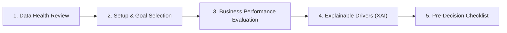

# Prediqo — Business-Friendly Prediction & Forecasting Guide

This guide explains how non-technical business users, analysts, and operators can use Prediqo’s predictive, forecasting, and explainable AI (XAI) capabilities without needing a background in data science or machine learning.

---

## 1. Executive Workflow Overview

Prediqo presents machine learning and forecasting through a structured 5-step operational workflow:

1. **Data Health Review**: Inspect cell completeness, total records, missing values, and data quality grade before modeling.
2. **Setup & Goal Selection**: Select what you want to predict (e.g. Sales, Churn, Demand) with automatic unit detection (`$`, `%`, `days`, `units`).
3. **Business Performance Evaluation**: Review plain-English metric translations (average expected error, variance explained, baseline comparison) rather than abstract formulas.
4. **Explainable Drivers (XAI)**: Understand *why* the model made each prediction—top positive drivers, top negative drivers, and scale disclosures.
5. **Pre-Decision Checklist**: Complete an operational safety checklist before committing real-world capital, inventory, or operational changes.

---

## 2. Step 1: Data Health & Quality Review

Before training any model, Prediqo assesses the dataset’s readiness and displays an authoritative **Data Quality & Health Card**:

| Indicator | Meaning | Target Benchmark |
| :--- | :--- | :--- |
| **Cell Completeness** | Percentage of non-null cells across the entire dataset. | > 95% is Excellent, > 85% is Good. |
| **Columns with Nulls** | Count of attributes containing missing observations. | View details to inspect which specific fields have missing data. |
| **Quality Grade** | Holistic grade (`Excellent`, `Good`, `Needs Attention`, `Insufficient`). | Datasets marked `Insufficient` require data cleaning before training. |
| **Total Rows** | Number of historical samples available for training and validation. | More rows generally improve model stability and generalizability. |

> [!TIP]
> Click **"View Missing Columns"** to see exact null counts and missing percentages for every affected field.

---

## 3. Step 2: Prediction vs Forecasting Setup

Prediqo provides two distinct predictive modes:

### A. Machine Learning Prediction (`Prediction Center`)
- **Use when**: You want to predict an outcome for an individual entity, transaction, customer, or account based on its characteristics.
- **Accessible via**: **Prediction Center** with consistent 4-tab navigation (`Overview`, `Analytics`, `AI Explanation`, `Technical Details`).
- **Regression (Numeric Measures)**: Predicts continuous values (e.g., Customer Lifetime Value in `$`, Delivery Delay in `days`, Order Quantity in `units`).
- **Classification (Categories & Status)**: Predicts discrete states (e.g., Churn `Yes`/`No`, Loan Approval `Approved`/`Rejected`).
- **Target Selection**: Displays inferred units, current null percentage, and a clear explanation of why the target is suitable.
- **Feature Selection**: Select which inputs the model is allowed to learn from. Excluded identifiers (IDs, dates) are automatically isolated.
- **Advanced Options**: Technical users can configure K-Fold cross-validation, time-aware chronological splits, or group-aware validation in the **Technical Details** tab.

### B. Time-Series Forecasting (`Forecasting Center`)
- **Use when**: You want to project how a metric evolves over future time periods (e.g., Total Sales over the next 14 days, Monthly Inquiries over the next 6 months).
- **Accessible via**: **Forecasting Center** with consistent 4-tab navigation (`Overview`, `Analytics`, `AI Explanation`, `Technical Details`).
- **Date Column**: The timestamp used to order historical records chronologically.
- **Metric Column**: The numeric measure to aggregate and project.
- **Frequency**: Daily, Weekly, or Monthly intervals.
- **Aggregation**: How transactions are combined per period (`SUM` for volume/revenue, `AVG` for rates/prices, `COUNT` for transactions).
- **Forecast Horizon**: The number of future periods to project (e.g., 7, 14, 30, or 60 periods).

---

## 4. Step 3: Interpreting Results in Plain English

Prediqo translates raw ML statistics into plain-language business insights:

### Regression Metrics Explained

| Metric | Technical Name | Business Meaning |
| :--- | :--- | :--- |
| **$R^2$ (Variance Explained)** | Coefficient of Determination | Explains what percentage of historical fluctuation is captured by the model. $R^2 = 0.85$ means the model explains 85% of variation, while 15% is driven by unmeasured external factors. |
| **MAE (Average Expected Error)** | Mean Absolute Error | On average, predictions are within $\pm \text{MAE}$ of actual outcomes. Expressed in original units (e.g. $\pm \$120.50$). |
| **RMSE (Peak-Volatility Error)** | Root Mean Squared Error | Penalizes large misses heavily. A large gap between RMSE and MAE indicates the model occasionally suffers from substantial outlier errors. |
| **MAPE (Relative Error)** | Mean Absolute Percentage Error | Average percentage deviation relative to actual values (e.g. within $8.5\%$ on average). |

### Classification Metrics Explained

| Metric | Technical Name | Business Meaning |
| :--- | :--- | :--- |
| **Accuracy** | Overall Accuracy | Proportion of correct predictions across all evaluation records (e.g., correct in 92 out of every 100 cases). |
| **Balanced Quality (F1)** | F1 Score | Balanced score combining precision and recall. Protects against misleading accuracy on imbalanced datasets. |
| **Precision** | Positive Predictive Value | False alarm filter: When the model predicts a status (e.g. "Fraud"), it is correct $X\%$ of the time. |
| **Recall** | True Positive Rate | Coverage rate: The model successfully catches $Y\%$ of all real occurrences, missing $100 - Y\%$. |

### Baseline Comparison
- **Improvement over Baseline**: Demonstrates whether the machine learning model genuinely outperforms simple naive guessing (e.g. historical average or last-period repetition).
- If a model shows `+24.5% vs Baseline`, it reduces error by 24.5% compared to naive historical guessing.

---

## 5. Step 4: Explainable AI (XAI) & Driver Attribution

Prediqo provides mathematical additive decompositions that explain *why* each prediction was made without black-box opacity.

### A. Local Prediction Drivers
- **Baseline Reference Point ($Y_0$)**: The model's starting point when all inputs are at training averages.
- **Positive Drivers ($\blacktriangle$)**: Features that push the predicted value upward.
- **Negative Drivers ($\blacktriangledown$)**: Features that pull the predicted value downward.

### B. Understanding Scales & Disclosures
- **Original Output Space**: For regression models, drivers are shown directly in original units (e.g. `+$10,000` or `-$1,500`).
- **Probability Space**: For random forest classifiers, drivers reflect changes in ensemble voting probability share.
- **Log-Odds Margin Space**: For logistic regression and gradient-boosted classifiers, drivers represent directional score adjustments along the decision boundary. They are not direct probability percentage points.

> [!IMPORTANT]
> **Statistical Attribution is NOT Causation**  
> Feature attribution reflects historical statistical patterns and correlations in the data. Changing an input in the real world will not automatically produce the predicted change in outcome. Always validate operational interventions with domain knowledge.

---

## 6. Step 5: Pre-Decision Operational Checklist

Before executing business decisions based on model predictions or forecasts, verify the standard 5-point operational checklist:

1. [ ] **Data Freshness & Relevance**: Ensure data reflects current business conditions and has not suffered from post-training regime shifts.
2. [ ] **Operational Error Tolerance**: Confirm the average expected error ($\pm \text{MAE}$) fits within your financial or operational margin tolerance.
3. [ ] **Uncertainty & Worst-Case Planning**: Review the 80% and 95% confidence bounds (forecasting) or alternative class probabilities (classification) to prepare for downside scenarios.
4. [ ] **Non-Causal Action Review**: Treat drivers as diagnostic signals, not guaranteed policy levers.
5. [ ] **Human-in-the-Loop Validation**: Review automated recommendations with experienced domain specialists before committing significant capital or policy changes.

---

## 7. Dedicated Technical Details Tab

For data scientists, ML engineers, and technical auditors, both centers provide a dedicated **Technical Details** tab containing:
- **Candidate Benchmark Tables**: Side-by-side comparison of all evaluated algorithms with cross-validation scores, holdout scores, baseline uplifts, and fitting runtimes.
- **Actual vs Predicted Holdout Charts**: Visual scatter/line comparison of holdout evaluation samples against ground truth.
- **Confusion Matrix & Per-Class Metrics**: Exact counts of true positives, false positives, true negatives, and false negatives.
- **Global Permutation Feature Importance**: Relative share of importance across the entire dataset with collinearity warnings.
- **Mathematical Reconstruction Logs**: Additive sums, reference definitions, and verified numerical reconstruction tolerances ($< 10^{-14}$).

