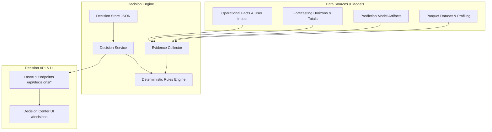
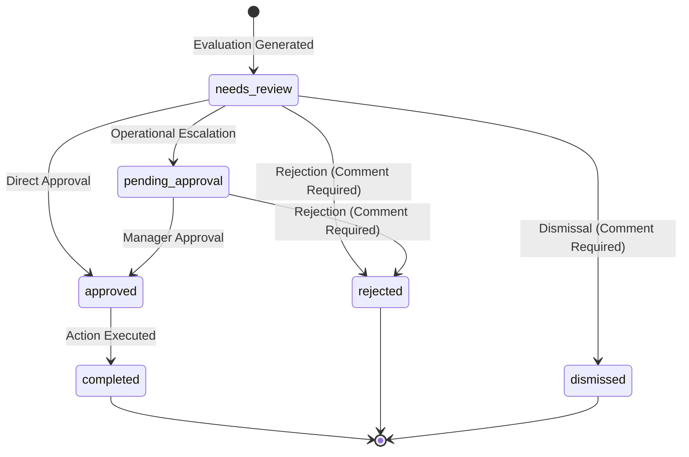

# Prediqo Decision Layer MVP — Architectural & Operational Guide

## 1. Executive Summary

The **Prediqo Decision Layer** translates validated Machine Learning predictions, statistical time-series forecasts, and dataset health metrics into structured, explainable, and deterministic business recommendations.

### Core Philosophy
1. **Zero Hallucination & Deterministic Logic**: Recommendations are driven by explicit business rules configured by stakeholders—never generated dynamically by an LLM or black-box heuristic.
2. **Zero Retraining Required**: Evaluates existing model artifacts and dataset profiles directly on disk without triggering recomputation or retraining.
3. **Evidence Traceability**: Every recommendation includes a full audit of the exact evaluated values, comparison operators, configured thresholds, units, and source models.
4. **Three-State Rule Evaluation**: Clearly separates `TRIGGERED`, `NOT_TRIGGERED`, and `NOT_EVALUABLE` (when required evidence or operational facts are missing or incompatible).
5. **Human-in-the-Loop Governance**: Preserves human agency with approval states (`needs_review`, `pending_approval`, `approved`, `rejected`, `completed`, `dismissed`). Mandatory rationale is enforced on rejection and dismissal.
6. **Explicit Non-Causal Disclosures**: Transparently discloses that recommendations are rule-based policy actions rather than guarantees of causal business improvement.

---

## 2. System Architecture

The Decision Layer operates as a decoupled service module within Prediqo:



### Backend Directory Structure (`backend/app/decisions/`)
- [`models.py`](file:///D:/AIML/prediqo-v2/backend/app/decisions/models.py): Pydantic schemas for `BusinessRule`, `RuleCreatePayload`, `EvidenceItem`, `RuleEvaluationResult`, `DecisionEvaluation`, `Recommendation`, `DecisionAuditItem`, and `DecisionOverviewStats`.
- [`rules_engine.py`](file:///D:/AIML/prediqo-v2/backend/app/decisions/rules_engine.py): Safe, AST-free deterministic evaluator supporting operators (`eq`, `neq`, `gt`, `gte`, `lt`, `lte`, `is_present`, `is_missing`), static thresholds, dynamic field-to-field comparisons, and unit compatibility checks.
- [`evidence_collector.py`](file:///D:/AIML/prediqo-v2/backend/app/decisions/evidence_collector.py): Fact aggregation service that inspects dataset metadata, model files, forecast horizons, and single-record predictions without retraining.
- [`store.py`](file:///D:/AIML/prediqo-v2/backend/app/decisions/store.py): Local JSON persistence managing `data/decisions/` (`rules.json`, `evaluations/`, `recommendations/`, `audit_log.json`). Pre-populates 6 seed rules on first boot.
- [`service.py`](file:///D:/AIML/prediqo-v2/backend/app/decisions/service.py): Orchestrates evaluation cycles, rule validation, recommendation synthesis, status updates with required comments, and audit logging.
- [`routes.py`](file:///D:/AIML/prediqo-v2/backend/app/decisions/routes.py): REST API endpoints under `/api/decisions`.

### Frontend Architecture (`frontend/src/`)
- [`types/decisionTypes.ts`](file:///D:/AIML/prediqo-v2/frontend/src/types/decisionTypes.ts): TypeScript interfaces for rules, evidence items, recommendations, and audit logs.
- [`services/decisionApi.ts`](file:///D:/AIML/prediqo-v2/frontend/src/services/decisionApi.ts): API client for all decision layer endpoints.
- [`utils/decisionUtils.ts`](file:///D:/AIML/prediqo-v2/frontend/src/utils/decisionUtils.ts): Value formatting, unit display, priority badge styling, and client-side form validation.
- [`components/decisions/DecisionOverview.tsx`](file:///D:/AIML/prediqo-v2/frontend/src/components/decisions/DecisionOverview.tsx): Executive KPI dashboard and recent actions.
- [`components/decisions/DecisionRecommendationsList.tsx`](file:///D:/AIML/prediqo-v2/frontend/src/components/decisions/DecisionRecommendationsList.tsx): Searchable, filterable recommendation cards with status pills.
- [`components/decisions/DecisionRecommendationCard.tsx`](file:///D:/AIML/prediqo-v2/frontend/src/components/decisions/DecisionRecommendationCard.tsx): Actionable recommendation card with supporting evidence pills.
- [`components/decisions/DecisionDetailModal.tsx`](file:///D:/AIML/prediqo-v2/frontend/src/components/decisions/DecisionDetailModal.tsx): Deep-dive audit modal displaying evidence table, limitations, and approval workflow.
- [`components/decisions/DecisionRulesPage.tsx`](file:///D:/AIML/prediqo-v2/frontend/src/components/decisions/DecisionRulesPage.tsx): Rules management page with scenario filters, active toggles, and deletion.
- [`components/decisions/DecisionRuleEditor.tsx`](file:///D:/AIML/prediqo-v2/frontend/src/components/decisions/DecisionRuleEditor.tsx): Rule editor with live specification validation before saving.
- [`components/decisions/DecisionEvaluateModal.tsx`](file:///D:/AIML/prediqo-v2/frontend/src/components/decisions/DecisionEvaluateModal.tsx): Interactive evaluation runner linking models, forecasts, and operational facts.
- [`components/decisions/DecisionHistoryPage.tsx`](file:///D:/AIML/prediqo-v2/frontend/src/components/decisions/DecisionHistoryPage.tsx): Chronological audit trail of all evaluations and status transitions.
- [`pages/DecisionCenterPage.tsx`](file:///D:/AIML/prediqo-v2/frontend/src/pages/DecisionCenterPage.tsx): Main top-level page with tab navigation.

---

## 3. Supported Scenarios & Seed Rules

Prediqo includes out-of-the-box business rules across five operational scenarios:

| Rule Name | Scenario | Evidence Source | Trigger Condition | Recommended Action |
|:---|:---|:---|:---|:---|
| **Inventory Stockout Alert** | `inventory` | `prediction` / `operational_fact` | `available_inventory < 100` | Initiate emergency purchase order to prevent supply disruption. |
| **Below Safety Stock Alert** | `inventory` | `operational_fact` | `available_inventory < safety_stock` | Create standard reorder batch with verified supplier lead times. |
| **Demand Peak Exceeds Capacity** | `demand` | `forecast` | `forecast_peak > available_capacity` | Schedule overtime shifts or procure temporary buffer warehouse capacity. |
| **High Customer Churn Risk** | `churn` | `prediction` | `predicted_churn_prob >= 0.70` | Trigger proactive customer success outreach and loyalty incentives. |
| **Severe Data Missingness Alert** | `data_quality` | `data_quality` | `missing_percentage > 20.0%` | Halt production inference and investigate upstream data ingestion. |
| **Model Degradation Tolerance** | `error_budget` | `model_metric` | `holdout_mape > 25.0%` | Flag model for retuning or fallback to conservative baseline forecast. |

---

## 4. Deterministic Rules Engine Specifications

### Supported Operators
- `gt` (`>`), `gte` (`>=`)
- `lt` (`<`), `lte` (`<=`)
- `eq` (`==`), `neq` (`!=`)
- `is_present` (value exists and is not null/empty)
- `is_missing` (value is null, NaN, or empty string)

### Evidence Status Classification
1. **`TRIGGERED`**: The condition evaluated successfully to `True`. Generates a formal recommendation.
2. **`NOT_TRIGGERED`**: The condition evaluated successfully to `False`. Rule criteria are within normal boundaries.
3. **`NOT_EVALUABLE`**: The required evidence field was absent from the dataset/inputs, or an incompatible type/unit comparison was attempted (e.g. comparing `days` with `$`). A clear warning is recorded in the evaluation diagnostics.

### Unit Compatibility Checking
To prevent erroneous business comparisons, the engine checks unit consistency:
- Comparing identical units (`units` vs `units`, `$` vs `$`) is fully supported.
- Comparing conflicting units (`days` vs `$`) marks the rule as `NOT_EVALUABLE` with an explicit incompatibility warning.

---

## 5. Human Review & Approval Lifecycle

Recommendations move through an explicit operational lifecycle:



### Governance Guarantees
- **Mandatory Rejection / Dismissal Justification**: If a user rejects or dismisses a recommendation, a reason comment is strictly required by both backend API validation and frontend UI forms.
- **Audit Logging**: Every status transition records the timestamp, actor, previous status, new status, target recommendation ID, and rationale in `data/decisions/audit_log.json`.

---

## 6. REST API Reference

All decision endpoints are hosted at `/api/decisions/*`:

| Method | Endpoint | Description |
|:---|:---|:---|
| `GET` | `/api/decisions/overview` | Retrieves KPI counts, active rule count, recent evaluations, and recent recommendations. |
| `GET` | `/api/decisions/scenarios` | Lists configured business scenarios and their expected fields. |
| `GET` | `/api/decisions/rules` | Lists business rules (filterable by `?scenario=` and `?enabled_only=`). |
| `POST` | `/api/decisions/rules` | Creates a new business rule. |
| `POST` | `/api/decisions/rules/validate` | Validates a rule specification prior to creation. |
| `GET` | `/api/decisions/rules/{rule_id}` | Retrieves a single rule by ID. |
| `PUT` | `/api/decisions/rules/{rule_id}` | Updates an existing business rule. |
| `PATCH`| `/api/decisions/rules/{rule_id}/toggle?enabled=true` | Toggles rule active/disabled status. |
| `DELETE`| `/api/decisions/rules/{rule_id}` | Permanently deletes a rule. |
| `POST` | `/api/decisions/evaluate` | Evaluates active rules against model/forecast/context inputs. |
| `GET` | `/api/decisions/evaluations` | Lists historical evaluation records. |
| `GET` | `/api/decisions/evaluations/{eval_id}` | Retrieves full evaluation result with rule breakdown. |
| `GET` | `/api/decisions/recommendations` | Lists recommendations (filterable by `?status=`, `?priority=`). |
| `GET` | `/api/decisions/recommendations/{rec_id}` | Retrieves a recommendation with evidence and limitations. |
| `POST` | `/api/decisions/recommendations/{rec_id}/status` | Updates recommendation status (`approved`, `rejected`, etc.). |
| `GET` | `/api/decisions/audit` | Retrieves chronological governance audit log. |

---

## 7. Local Persistence Details

All decision records are stored locally in `data/decisions/`:
- `data/decisions/rules.json`: Configured business rules.
- `data/decisions/evaluations/{eval_id}.json`: Complete record of each evaluation run.
- `data/decisions/recommendations/{rec_id}.json`: Active and historical recommendations.
- `data/decisions/audit_log.json`: Chronological audit trail.

This storage structure ensures that decision state persists across application restarts, requires no external database, and maintains local data privacy.

---

## 8. Verification & Test Suite

### Backend Pytest Suite (15 Tests)
Run the backend tests:
```powershell
$env:PYTHONPATH="backend"
.\backend\.venv\Scripts\python.exe -m pytest backend/tests/test_decisions.py -v
```
All tests verify:
1. Deterministic comparison operators (`gt`, `lt`, `eq`, `neq`, `is_present`, `is_missing`).
2. Type coercion and unit compatibility.
3. Proper handling of missing evidence as `NOT_EVALUABLE`.
4. Rule persistence and seed rule bootstrapping.
5. Evaluation execution without model retraining.
6. Mandatory comment validation on rejection and dismissal.
7. End-to-end FastAPI endpoint integration via `TestClient`.

### Frontend Test Suite (5 Tests)
Run the frontend test suite:
```powershell
npx tsx --test frontend/tests/decisionRules.test.ts
```
Verifies evidence formatting, priority badges, status transitions, comment requirements, and client-side form validation.

