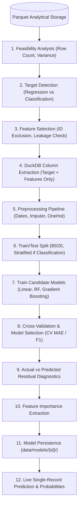

# Prediqo — Supervised Machine Learning Prediction Layer

## 1. Architecture Overview

Prediqo's **Supervised Prediction Layer** (`backend/app/prediction/`) equips the platform with record-level predictive analytics alongside descriptive analytics ([docs/ANALYTICS.md](docs/ANALYTICS.md)) and time-series forecasting ([docs/FORECASTING.md](docs/FORECASTING.md)).

It implements the principle of strict separation between **ML computation** and **AI/LLM reasoning**:

```text
                                PREDIQO PLATFORM
                                       |
        +------------------------------+------------------------------+
        |                                                             |
        v                                                             v
SUPERVISED PREDICTION (Record-Level ML)              TIME-SERIES FORECASTING (Chronological)
"What will the value be for this record?"            "What will aggregate values be over time?"
- Objective: Estimate target from row features       - Objective: Project temporal series into future
- Validation: K-Fold CV / Chronological Split        - Validation: Chronological backtesting (N - H vs H)
- Input: Arbitrary feature vector                    - Input: Date column, metric, frequency, horizon
- Models: Linear, Random Forest, GBDT                - Models: Naive, Seasonal Naive, Moving Avg, Exp Smoothing
- Inference: POST /api/prediction/predict            - Inference: POST /api/forecast/predict
```

### Core Design Rules
1. **Local-First & Lightweight**: Built with `scikit-learn` and `joblib`. No external queue brokers, heavy Docker clusters, or cloud ML dependencies.
2. **Deterministic ML**: All numeric metrics, model evaluations, predictions, and feature importances come directly from underlying mathematical estimators, never invented by LLMs.
3. **Data Source Integration**: Directly queries column-pruned Parquet datasets (`data/datasets/{id}.parquet`) via DuckDB without reloading raw CSV/Excel files or materializing entire DataFrames into memory.
4. **Dataset Version Awareness**: Models are strictly associated with `(dataset_id, dataset_version)`. Any dataset refresh prevents silent usage of stale models.

---

## 2. End-to-End Data Flow



---

## 3. Target Detection & Selection (`target_detector.py`)

Target detection leverages the existing Semantic Intelligence layer:

- **Regression Targets**:
  - `semantic_type == 'MEASURE'` or numeric continuous columns with cardinality $> 5$ and non-zero variance.
  - Priority business roles: `duration`, `revenue`, `cost`, `profit`, `sales`, `monetary_amount`, `price`, `rating`, `rate`.
- **Classification Targets**:
  - `semantic_type in ('CATEGORY', 'DIMENSION')` or small discrete numeric columns with $2 \le \text{unique} \le 30$.
  - Priority business roles: `status`, `churn`, `fraud`, `risk`, `category`, `payment_method`.
- **Target Exclusion**:
  - Identifiers (`ID`, `order_id`, `customer_id`, `uuid`, `key`, `code`).
  - Columns with zero variance or 100% missing values.
  - Freeform text columns with high cardinality ($> 50$ unique strings).
  - Date columns (`DATE`).

---

## 4. Feature Selection & Data Leakage Prevention (`feature_selector.py`)

- **Recommended Features**:
  - Numeric continuous columns, categorical categories with $< 100$ unique values, and date columns.
- **Excluded Features**:
  - Target column itself.
  - All identifier columns (`is_identifier_column`).
  - Completely null or single-value columns.
  - High-cardinality text columns ($> 100$ unique values or $> 80\%$ unique-to-row ratio).
- **Post-Outcome Leakage Heuristics**:
  - Evaluates predictor names against target names to detect post-outcome information.
  - E.g., if target is `Delivery_Days`, the system warns if `Actual_Delivery_Date`, `Delivered_At`, or `Delivery_Status` are selected as predictors.
  - E.g., if target is `Order_Status`, warns if `Cancellation_Reason` or `Refund_Amount` are selected.
- **Correlation Leakage Detection (`check_correlation_leakage`)**:
  - Computes pairwise Pearson correlation between candidate numeric features and the target.
  - Flags any feature with $|\rho| \ge 0.98$ as a critical data leakage warning for user review.

---

## 5. Pipeline Preprocessing (`data_preparation.py`)

Preprocessing and model estimators are bundled into a single atomic scikit-learn `Pipeline`:

1. **Date Feature Extractor (`DateFeatureExtractor`)**:
   - Decomposes `DATE` columns into numeric features: `_year`, `_month`, `_day`, `_dayofweek`, `_quarter`.
2. **ColumnTransformer**:
   - **Numeric Pipeline**: `SimpleImputer(strategy="median")`.
   - **Categorical Pipeline**: `SimpleImputer(strategy="most_frequent")` $\rightarrow$ `OneHotEncoder(handle_unknown="ignore", sparse_output=False)`.
3. **Immutability**:
   - Because the preprocessor is embedded directly in the pipeline, inference calls with `predict(df)` execute the exact same transformations as training.

---

## 6. Model Training & Candidate Algorithms (`trainer.py`)

For every training job, three diverse algorithms are trained:

### Regression Candidates
1. `LinearRegression` (Standard OLS baseline)
2. `RandomForestRegressor` (Bagged ensemble, $N=50$)
3. `GradientBoostingRegressor` (Boosted decision trees, $N=50$)

### Classification Candidates
1. `LogisticRegression` (Linear classifier, `max_iter=1000`)
2. `RandomForestClassifier` (Bagged ensemble, $N=50$)
3. `GradientBoostingClassifier` (Boosted trees, $N=50$)

Execution runtime is tracked per pipeline in milliseconds (`training_time_ms`).

---

## 7. Model Evaluation, Cross-Validation & Selection (`evaluator.py`)

Models are evaluated using both K-Fold Cross-Validation (or chronological `TimeSeriesSplit`) and holdout evaluation:

### Validation Strategies
- **K-Fold Cross-Validation** ($K=5$ default, configurable $2 \le K \le 10$):
  - Preprocessing is fitted strictly within each training fold using cloned pipeline estimators to guarantee zero cross-fold leakage.
  - Computes mean and standard deviation across all folds: `cv_mae_mean`, `cv_mae_std`, `cv_rmse_mean`, `cv_r2_mean`.
- **Chronological Split (`TimeSeriesSplit`)**:
  - Used when observations have temporal dependencies to prevent lookahead leakage.
- **Holdout Test Set (20%)**:
  - Evaluates generalization on unseen holdout records.

### Model Selection Policy
- **Regression**:
  - Primary Metric: **Lowest Cross-Validation MAE** (`cv_metrics.mae`).
  - Supporting Metrics: Holdout MAE, RMSE, and $R^2$.
- **Classification**:
  - Primary Metric: **Highest Weighted F1 Score**.
  - Supporting Metrics: Accuracy, Precision, Recall.
- The candidate with the optimal primary metric is automatically marked `is_best: true` and saved as the active model.

### Actual vs. Predicted Residual Diagnostics
For regression models, residual points are calculated on the held-out test split:
```python
residual = actual - predicted
```
Points `[{ record_index, actual, predicted, residual }]` are returned for interactive scatter plotting in the frontend.

---

## 8. Feature Importance (`feature_importance.py`)

- **Tree Models**: Extracted via `feature_importances_`.
- **Linear Models**: Extracted via coefficient magnitudes (`np.abs(coef_)`).
- **One-Hot Inverse Mapping**:
  - One-hot encoded dummy features (e.g. `City_Bangalore`, `City_Mumbai`) are mapped back to their root column (`City`) and aggregated.
  - Importances are normalized to proportional values summing to $1.0$.

---

## 9. Model Persistence & Version Safety (`model_store.py`)

Trained artifacts are persisted to `data/models/{model_id}/`:
- `model.joblib`: Serialized trained scikit-learn Pipeline.
- `metadata.json`: Model configuration, algorithm, features, row counts, creation timestamp, and dataset version.
- `metrics.json`: Candidate model comparison metrics, cross-validation metrics, actual-vs-predicted points, and best model summary.
- `feature_schema.json`: Expected input features with data types and sample values.

### Version Safety
If a dataset is refreshed and increments from `v1` to `v2`, inference requests against a model trained on `v1` return an informative rejection:
```
"Dataset version mismatch: Model 'model_123' was trained on version 1, but dataset is now on version 2. Please retrain."
```

---

## 10. API Reference & Examples

### 1. Feasibility Check
`GET /api/prediction/feasibility/{dataset_id}`

**Response**:
```json
{
  "dataset_id": "ds_a377a26e",
  "dataset_version": 1,
  "row_count": 8680,
  "prediction_possible": true,
  "regression_targets": [
    { "name": "Delivery_Days", "dtype": "int64", "business_role": "duration", "display_name": "Delivery Days", "problem_type": "regression" }
  ],
  "classification_targets": [
    { "name": "Order_Status", "dtype": "object", "business_role": "status", "display_name": "Order Status", "problem_type": "classification", "classes": ["Delivered", "Cancelled", "Pending"] }
  ],
  "recommended_targets": ["Delivery_Days", "Order_Status"],
  "warnings": []
}
```

### 2. Train Models
`POST /api/prediction/train`

**Payload**:
```json
{
  "dataset_id": "ds_a377a26e",
  "target_column": "Delivery_Days",
  "problem_type": "regression",
  "features": ["Customer_Age", "City", "Product_Category", "Quantity", "Unit_Price", "Discount_Percent"],
  "test_size": 0.2,
  "cv_folds": 5,
  "validation_strategy": "k_fold",
  "random_state": 42
}
```

**Response**:
```json
{
  "model_id": "model_b9a14e72",
  "dataset_id": "ds_a377a26e",
  "dataset_version": 1,
  "target_column": "Delivery_Days",
  "problem_type": "regression",
  "selected_features": ["Customer_Age", "City", "Product_Category", "Quantity", "Unit_Price", "Discount_Percent"],
  "best_model": {
    "algorithm": "GradientBoostingRegressor",
    "primary_metric": "cv_mae",
    "primary_metric_value": 4.88,
    "metrics": { "mae": 5.02, "rmse": 7.21, "r2": 0.89 },
    "cv_metrics": { "mae": 4.88, "rmse": 6.94, "r2": 0.90 }
  },
  "candidate_models": [
    {
      "algorithm": "LinearRegression",
      "metrics": { "mae": 8.42, "rmse": 11.20, "r2": 0.71 },
      "cv_metrics": { "mae": 8.35, "rmse": 11.10, "r2": 0.72 },
      "training_time_ms": 42.1,
      "is_best": false
    },
    {
      "algorithm": "GradientBoostingRegressor",
      "metrics": { "mae": 5.02, "rmse": 7.21, "r2": 0.89 },
      "cv_metrics": { "mae": 4.88, "rmse": 6.94, "r2": 0.90 },
      "training_time_ms": 284.5,
      "is_best": true
    }
  ],
  "actual_vs_predicted": [
    { "record_index": 0, "actual": 4.0, "predicted": 4.2, "residual": -0.2 }
  ],
  "training_row_count": 6944,
  "test_row_count": 1736,
  "feature_importance": [
    { "feature": "Quantity", "importance": 0.42 },
    { "feature": "Product_Category", "importance": 0.28 }
  ],
  "warnings": []
}
```

### 3. Make Prediction
`POST /api/prediction/predict`

**Payload**:
```json
{
  "model_id": "model_b9a14e72",
  "features": {
    "Customer_Age": 28,
    "City": "Bangalore",
    "Product_Category": "Electronics",
    "Quantity": 2,
    "Unit_Price": 1500.0,
    "Discount_Percent": 10
  }
}
```

**Response**:
```json
{
  "model_id": "model_b9a14e72",
  "prediction": 3.82,
  "unit": "days",
  "problem_type": "regression",
  "probabilities": null,
  "explanation": "Predicted Delivery_Days is 3.82 days based on Quantity (42%), Product_Category (28%) using GradientBoostingRegressor.",
  "warnings": []
}
```

---

---

## 11. Frontend User Interface (`PredictionTab.tsx`)

The Supervised Prediction view provides:
1. **Target & Problem Selector**: Choose target variable, view problem type (Regression vs Classification), and inspect recommended features.
2. **Validation Controls**: Select cross-validation fold count ($2 \dots 10$) and splitting strategy (`kfold`, `time_aware`, `group_kfold` with selectable group column).
3. **Leakage & Feature Exclusions**: Real-time warnings for correlation leakage ($|\rho| \ge 0.98$) and post-outcome leakage.
4. **Candidate Leaderboard & Baseline Benchmarking**: Comparison table displaying training time, CV MAE, holdout MAE, RMSE, $R^2$, and benchmark comparison against `DummyRegressor`/`DummyClassifier` (`vs Baseline %`).
5. **Classification Diagnostics**: $N \times N$ Confusion Matrix and Per-Class breakdown (Precision, Recall, F1 score).
6. **Reliability Diagnostic Banner**: Automatic alerts for small sample sizes ($N < 20$) and severe class imbalance ($> 10:1$).
7. **Holdout Residual Chart**: Actual vs. predicted fit line chart with residuals.
8. **Feature Importance Chart**: Proportional bar chart displaying the top driving features.
9. **Live Inference Form**: Auto-generated dynamic input fields with uncalibrated probability notice and instant predictions.

---

## 12. Phase 3 Predictive Reliability & Leakage Prevention

1. **Data Leakage Safeguards**:
   - Learned transformations (imputers, one-hot encoders, standard scalers) fitted exclusively on train folds within cross-validation.
   - Identifier columns and post-outcome timestamps/flags heuristically excluded from candidate features.
   - High correlation ($|\rho| \ge 0.98$) flagged with leakage warnings.
2. **Validation Strategy Flexibility**:
   - `KFold`: Independent observations (stratified automatically for classification).
   - `time_aware`: Chronological holdout splitting for temporal records.
   - `group_kfold`: Group-aware splitting (`GroupShuffleSplit` / `GroupKFold`) preventing entity leakage (customer, order, account).
3. **Baseline Model Comparison**:
   - Always evaluates dummy estimators (`DummyRegressor(strategy='mean')` / `DummyClassifier(strategy='most_frequent')`).
   - Reports `vs_baseline_pct` for all candidate models.
4. **Edge-Case Resilience**:
   - Zero-crash fallback when requested CV folds exceed dataset sample size.
   - Unseen categories at inference time handled via `OneHotEncoder(handle_unknown='ignore')`.
   - Missing values in features imputed during pipeline inference.

---

## 13. Roadmap for Further Prediction Development

1. **Batch Inference & File Upload**:
   - `POST /api/prediction/batch`: Upload a CSV of unlabelled records and download predictions as an enriched CSV.
2. **SHAP Tree Explainability**:
   - Compute exact Shapley values (`shap.TreeExplainer`) for per-record local feature contribution waterfalls.
3. **Automated Hyperparameter Optimization**:
   - Lightweight randomized search or Optuna tuning across tree depth, learning rate, and estimator counts.
4. **Imbalanced Classification Safeguards**:
   - SMOTE oversampling or balanced class weighting for severe target class skews.
