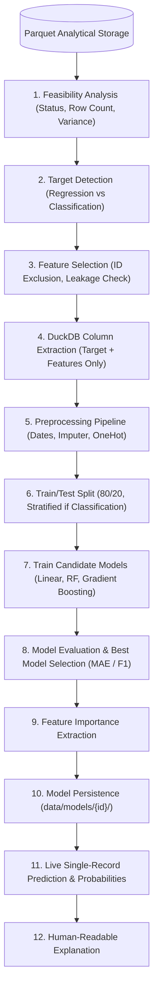

# Prediqo — Supervised Machine Learning Prediction Layer

## 1. Architecture Overview

Prediqo's Supervised Prediction Layer equips the platform with predictive analytics alongside descriptive and diagnostic analytics. It implements the principle of strict separation between **ML computation** and **AI/LLM reasoning**:

```text
                    PREDIQO PLATFORM
                           |
        +------------------+------------------+
        |                                     |
        v                                     v
    ANALYTICS (DuckDB)               PREDICTION (ML Engine)
   "What happened?"                  "What will happen?"
   Aggregation & SQL                 Supervised Regression / Classification
        |                                     |
        +------------------+------------------+
                           |
                           v
                    AI EXPLANATION
```

### Core Design Rules
1. **Local-First & Lightweight**: Built with `scikit-learn` and `joblib`. No heavy external dependencies (no TensorFlow, PyTorch, MLflow, Docker, or external queue brokers).
2. **Deterministic ML**: All numeric metrics, model evaluations, predictions, and feature importances come directly from the underlying mathematical models, never invented by LLMs.
3. **Data Source Integration**: Directly queries column-pruned Parquet datasets (`data/datasets/{id}.parquet`) via DuckDB without reloading raw CSV/Excel files or materializing entire DataFrames into memory.
4. **Dataset Version Awareness**: Models are strictly associated with `(dataset_id, dataset_version)`. Any dataset refresh prevents silent usage of stale models.

---

## 2. End-to-End Data Flow



---

## 3. Target Detection & Selection

Target detection leverages the existing Semantic Intelligence layer:

- **Regression Targets**:
  - `semantic_type == 'MEASURE'` or numeric continuous columns with cardinality $> 5$ and non-zero variance.
  - Priority business roles: `duration`, `revenue`, `cost`, `profit`, `sales`, `monetary_amount`, `price`, `rating`, `rate`.
- **Classification Targets**:
  - `semantic_type in ('CATEGORY', 'DIMENSION')` or small discrete numeric columns with $2 \le \text{unique} \le 30$.
  - Priority business roles: `status`, `churn`, `fraud`, `risk`, `category`, `payment_method`.
- **Target Exclusion**:
  - Identifiers (`ID`, `order_id`, `customer_id`, `uuid`, `key`, `code`).
  - Columns with zero variance or 100% missing values.
  - Freeform text columns with high cardinality ($> 50$ unique strings).
  - Date columns (`DATE`).

---

## 4. Feature Selection & Data Leakage Prevention

- **Recommended Features**:
  - Numeric columns, categorical categories with $< 100$ unique values, and date columns.
- **Excluded Features**:
  - Target column itself.
  - All identifier columns (`is_identifier_column`).
  - Completely null or single-value columns.
  - High-cardinality text columns ($> 100$ unique values or $> 80\%$ unique-to-row ratio).
- **Data Leakage Heuristics**:
  - Evaluates predictor names against target names to detect post-outcome information.
  - E.g., if target is `Delivery_Days`, the system warns if `Actual_Delivery_Date`, `Delivered_At`, or `Delivery_Status` are selected as predictors.
  - E.g., if target is `Order_Status`, warns if `Cancellation_Reason` or `Refund_Amount` are selected.

---

## 5. Pipeline Preprocessing

Preprocessing and model estimators are bundled into a single atomic scikit-learn `Pipeline`:

1. **Date Feature Extractor (`DateFeatureExtractor`)**:
   - Decomposes `DATE` columns into numeric features: `_year`, `_month`, `_day`, `_dayofweek`, `_quarter`.
2. **ColumnTransformer**:
   - **Numeric Pipeline**: `SimpleImputer(strategy="median")`.
   - **Categorical Pipeline**: `SimpleImputer(strategy="most_frequent")` $\rightarrow$ `OneHotEncoder(handle_unknown="ignore", sparse_output=False)`.
3. **Immutability**:
   - Because the preprocessor is embedded directly in the pipeline, inference calls with `predict(df)` execute the exact same transformations as training.

---

## 6. Model Training & Candidate Algorithms

For every training job, three diverse algorithms are trained:

### Regression Candidates
1. `LinearRegression` (Standard OLS baseline)
2. `RandomForestRegressor` (Bagged ensemble, $N=50$)
3. `GradientBoostingRegressor` (Boosted decision trees, $N=50$)

### Classification Candidates
1. `LogisticRegression` (Linear classifier, `max_iter=500`)
2. `RandomForestClassifier` (Bagged ensemble, $N=50$)
3. `GradientBoostingClassifier` (Boosted trees, $N=50$)

---

## 7. Model Evaluation & Selection

Models are evaluated against the held-out test set ($20\%$):

- **Regression**:
  - Metrics: **MAE** (Mean Absolute Error), **RMSE** (Root Mean Squared Error), **$R^2$** (Coefficient of Determination).
  - Primary Metric: **Lowest MAE**.
- **Classification**:
  - Metrics: **Accuracy**, **Precision** (weighted), **Recall** (weighted), **F1 Score** (weighted).
  - Primary Metric: **Highest F1 Score**.
- The candidate with the optimal primary metric is automatically marked `is_best: true` and saved as the active model.

---

## 8. Feature Importance

- **Tree Models**: Extracted via `feature_importances_`.
- **Linear Models**: Extracted via coefficient magnitudes (`np.abs(coef_)`).
- **One-Hot Inverse Mapping**:
  - One-hot encoded dummy features (e.g. `City_Bangalore`, `City_Mumbai`) are mapped back to their root column (`City`) and aggregated.
  - Importances are normalized to proportional values summing to $1.0$.

---

## 9. Model Persistence & Version Safety

Trained artifacts are persisted to `data/models/{model_id}/`:
- `model.joblib`: Serialized trained scikit-learn Pipeline.
- `metadata.json`: Model configuration, algorithm, features, row counts, creation timestamp, and dataset version.
- `metrics.json`: Candidate model comparison metrics and best model summary.
- `feature_schema.json`: Expected input features with data types and sample values.

### Version Safety
If a dataset is refreshed and increments from `v1` to `v2`, inference requests against a model trained on `v1` return an informative rejection:
```
"Dataset version mismatch: Model 'model_123' was trained on version 1, but dataset is now on version 2. Please retrain."
```

---

## 10. API Reference & Examples

### 1. Feasibility Check
`GET /api/prediction/feasibility/{dataset_id}`

**Response**:
```json
{
  "dataset_id": "ds_a377a26e",
  "dataset_version": 1,
  "row_count": 8680,
  "prediction_possible": true,
  "regression_targets": [
    { "name": "Delivery_Days", "dtype": "int64", "business_role": "duration", "display_name": "Delivery Days", "problem_type": "regression" }
  ],
  "classification_targets": [
    { "name": "Order_Status", "dtype": "object", "business_role": "status", "display_name": "Order Status", "problem_type": "classification", "classes": ["Delivered", "Cancelled", "Pending"] }
  ],
  "recommended_targets": ["Delivery_Days", "Order_Status"],
  "warnings": []
}
```

### 2. Train Models
`POST /api/prediction/train`

**Payload**:
```json
{
  "dataset_id": "ds_a377a26e",
  "target_column": "Delivery_Days",
  "problem_type": "regression",
  "features": ["Customer_Age", "City", "Product_Category", "Quantity", "Unit_Price", "Discount_Percent"],
  "test_size": 0.2,
  "random_state": 42
}
```

**Response**:
```json
{
  "model_id": "model_b9a14e72",
  "dataset_id": "ds_a377a26e",
  "dataset_version": 1,
  "target_column": "Delivery_Days",
  "problem_type": "regression",
  "selected_features": ["Customer_Age", "City", "Product_Category", "Quantity", "Unit_Price", "Discount_Percent"],
  "best_model": {
    "algorithm": "GradientBoostingRegressor",
    "primary_metric": "mae",
    "primary_metric_value": 5.02,
    "metrics": { "mae": 5.02, "rmse": 7.21, "r2": 0.89 }
  },
  "candidate_models": [
    { "algorithm": "LinearRegression", "metrics": { "mae": 8.42, "rmse": 11.20, "r2": 0.71 }, "is_best": false },
    { "algorithm": "RandomForestRegressor", "metrics": { "mae": 5.31, "rmse": 7.84, "r2": 0.87 }, "is_best": false },
    { "algorithm": "GradientBoostingRegressor", "metrics": { "mae": 5.02, "rmse": 7.21, "r2": 0.89 }, "is_best": true }
  ],
  "training_row_count": 6944,
  "test_row_count": 1736,
  "feature_importance": [
    { "feature": "Quantity", "importance": 0.42 },
    { "feature": "Product_Category", "importance": 0.28 }
  ],
  "warnings": []
}
```

### 3. Make Prediction
`POST /api/prediction/predict`

**Payload**:
```json
{
  "model_id": "model_b9a14e72",
  "features": {
    "Customer_Age": 28,
    "City": "Bangalore",
    "Product_Category": "Electronics",
    "Quantity": 2,
    "Unit_Price": 1500.0,
    "Discount_Percent": 10
  }
}
```

**Response**:
```json
{
  "model_id": "model_b9a14e72",
  "prediction": 3.82,
  "unit": "days",
  "problem_type": "regression",
  "probabilities": null,
  "explanation": "Predicted Delivery_Days is 3.82 days based on Quantity (42%), Product_Category (28%) using GradientBoostingRegressor.",
  "warnings": []
}
```

---

## 11. Known Limitations (Phase 1)

1. **Local-First Single Machine**: Training executes in-process on the local server. Datasets exceeding $100\text{k}$ rows are capped/sampled to $50\text{k}$ rows to ensure responsive performance.
2. **Heuristic Leakage Detection**: The system identifies obvious post-outcome keywords (e.g. `Actual_Delivery_Date` vs `Delivery_Days`), but domain-specific data leakage requires domain knowledge and human inspection.
3. **No Distributed Training**: No Spark, Ray, or GPU acceleration.

---

## 12. Future Roadmap

- **Phase 2**: Batch inference, CSV predictions upload, SHAP tree explainability, prediction history logging.
- **Phase 3**: Time-series forecasting (ARIMA, Prophet, lag-feature gradient boosting) for future revenue and demand over time.
- **Phase 4**: Decision Intelligence Engine (scenario simulation, what-if sensitivity analysis, prescriptive recommendations).
